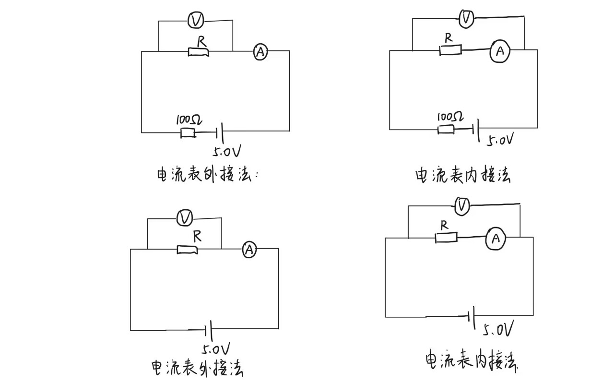
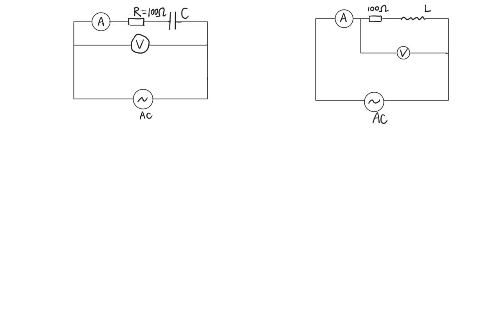

# 东南大学电工电子实验中心

## 实 验 报 告

课程名称：电路实验

第 1、3 次实验

实验名称：电子元器件识别参数测试及常用仪器使用

院（系）：电子科学与工程学院　专业：电子科学与技术

姓　　名：zhz　　学　　号：（已隐去）

实 验 室：403室　　实验组别：

同组人员：　　实验时间：2025年11月29日

---

## 一、实验目的

1. 掌握基本仪器的使用。
2. 了解电流表电压表的物理模型，运用欧姆定律，通过对测量误差的分析、推理，掌握电流表内接法、电流表外接法等测量方法；通过对不同测量方法产生误差的估算、分析，建立技术方法存在适用范围的概念。
3. 了解二极管、稳压二极管的特性与应用特点，掌握稳压管伏安特性测量方法。

## 二、实验原理

**电阻测量与误差分析**

- 电流表内接法：电压表测量值为电阻与电流表内阻之和的压降，适用于测量较大电阻（Rx≫RA）。
- 电流表外接法：电流表测量值为电阻与电压表内阻并联的总电流，适用于测量较小电阻（Rx≪RV）。

**电容与电感的交流阻抗特性**

- 电容的容抗：XC = 1/(2πfC)
- 电感的感抗：XL = 2πfL

## 三、实验内容

**（1）用数字万用表直接测量电阻（10Ω、2MΩ）、电容（0.022μF）的参数**

| 项目 | 10Ω电阻 | 2MΩ电阻 |
|------|---------|---------|
| 测量值 | 9.926Ω | 2.2114MΩ |
| 标称阻值 | 10Ω | 2MΩ |
| 相对误差 | -0.74% | +10.57% |

| 项目 | 电容1 | 电容2 |
|------|-------|-------|
| 电容测量结果 | 0.0241μF | 0.0218μF |
| 标称值 | 0.022μF | 0.022μF |
| 相对误差 | +9.54% | -0.91% |

**（2）设计电路，进行电阻阻值的测量（10Ω，2MΩ）**

a）选择合适的电源电压，分别用电流表内接和电流表外接两种方法测量每个电阻阻值。

10Ω电阻测量电路（电流表内接、电流表外接并标注参数）：

2MΩ电阻测量电路（电流表内接、电流表外接并标注参数）：

b）记录测量数据，对比分析测量误差及误差原因，并以提高测量精度为准则给出实验结论。

| 电源电压(V) | 测量对象（标称值） | 测量方法 | 电压(V) | 电流(I) | 电阻(Ω) | 相对误差（%） |
|-----------|------------------|----------|---------|---------|---------|---------------|
| 5.0 | 10Ω | 电流表内接 | 0.53V | 47.24mA | 11.22 | +13.04% |
| 5.0 | 10Ω | 电流表外接 | 0.47V | 47.28mA | 9.94 | +0.14% |
| 5.0 | 2MΩ | 电流表内接 | 5.11V | 2.27μA | 2.25×10⁶ | +1.75% |
| 5.0 | 2MΩ | 电流表外接 | 5.11V | 2.82μA | 1.81×10⁶ | -18.15% |

实验数据分析（误差和误差原因）：

1. **10Ω电阻测量**：
   - 电流表内接法：测量值11.22Ω，相对误差+13.04%。误差较大，原因是电流表内接时电压表测量的是电阻和电流表两端的总电压，电流表内阻引入额外压降，导致计算出的电阻值偏大。对于小电阻（如10Ω），电流表内阻的影响显著。
   - 电流表外接法：测量值9.94Ω，相对误差+0.14%。误差较小，原因是电流表外接时电压表内阻很大（MΩ级），分流效应很小，对小电阻测量影响小。

2. **2MΩ电阻测量**：
   - 电流表内接法：测量值2.25×10⁶Ω，相对误差+1.75%。误差较小，原因是电流表内阻远小于2MΩ，其压降可忽略。
   - 电流表外接法：测量值1.81×10⁶Ω，相对误差-18.15%。误差较大，原因是电压表内阻与2MΩ电阻可比，电压表分流导致电流表读数偏大，计算出的电阻值偏小。

3. **实验结论**：小电阻优先用电流表外接法；大电阻优先用电流表内接法。选择依据：当 R≪RV（电压表内阻）时用外接法；当 R≫RA（电流表内阻）时用内接法。

**（3）测量电容（0.022μF）和电感（330μH）**

a）选择信号源作为激励源，选择信号频率，计算相应理论容抗、感抗。

| 选择频率 | 理论容抗 | 选择频率 | 理论感抗 |
|----------|----------|----------|----------|
| 1kHz | 7234.33Ω | 10kHz | 20.74Ω |
| 10kHz | 723.43Ω | 20kHz | 41.47Ω |

b）选择测量方法，画出测量电路（电源有效值：电容测量5V，电感测量7V）。

c）测量并记录实验数据，计算实际测量参数和相对误差。

| 激励源频率(Hz) | 测量对象（标称值） | 测量方法 | 电压(V) | 电流(I) | 元件参数 | 误差（%） |
|----------------|------------------|----------|---------|---------|----------|-----------|
| 1k | 0.022μF | 内接法 | 4.9954V | 0.7530mA | 0.0240μF | +9.10% |
| 10k | 0.022μF | 内接法 | 4.877V | 6.9837mA | 0.0230μF | +4.54% |
| 10k | 330μH | 外接法 | 4.5771V | 44.902mA | 315.87μH | -4.76% |
| 20k | 330μH | 外接法 | 4.7318V | 43.367mA | 347.33μH | +5.52% |

d）思考：如何提高测量精度？

- 优化频率选择：电容选较高频率（如10kHz以上）；电感选更高频率使其感抗远大于电阻。
- 改进测量电路：适当提高电压以降低误差；换用正常的元件重新测量。

## 四、实验总结

**出现的问题与解决方法**：

1. 测量电阻时误差较大 → 通过分析误差原因，选择合适的电流表接法。
2. 电容电感测量误差较大 → 适当提高电压值，换用正常的元件重新测量。

**收获体会**：

通过本次实验，我系统掌握了常用电子元器件的识别、参数测量与仪器使用方法。在电阻测量中，通过对比电流表内接与外接法的误差，我深入理解了测量方法对结果的影响，并学会了根据待测电阻大小合理选择测量方式。在不同元件、不同条件下的测量误差分析中，我认识到仪器精度、频率选择等因素对测量结果的影响，初步掌握了通过优化实验条件减小误差的方法。本次实验不仅巩固了电路基本理论与测量知识，也让我认识到严谨的实验态度与科学的分析方法在工程实践中的重要性。
