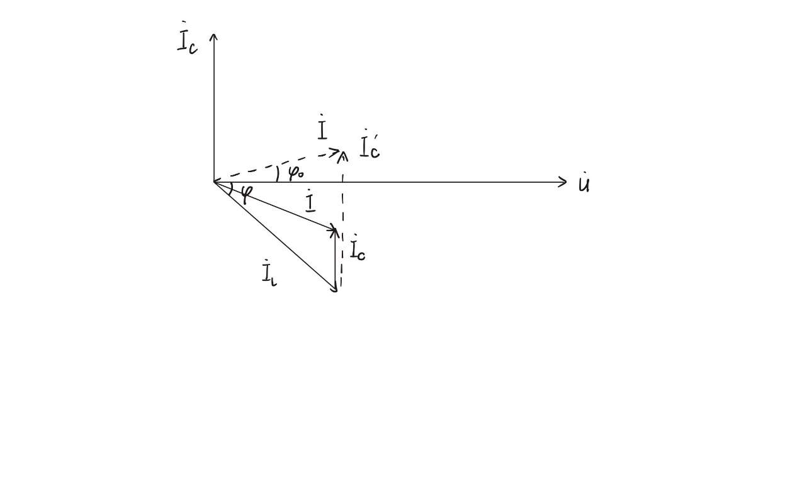
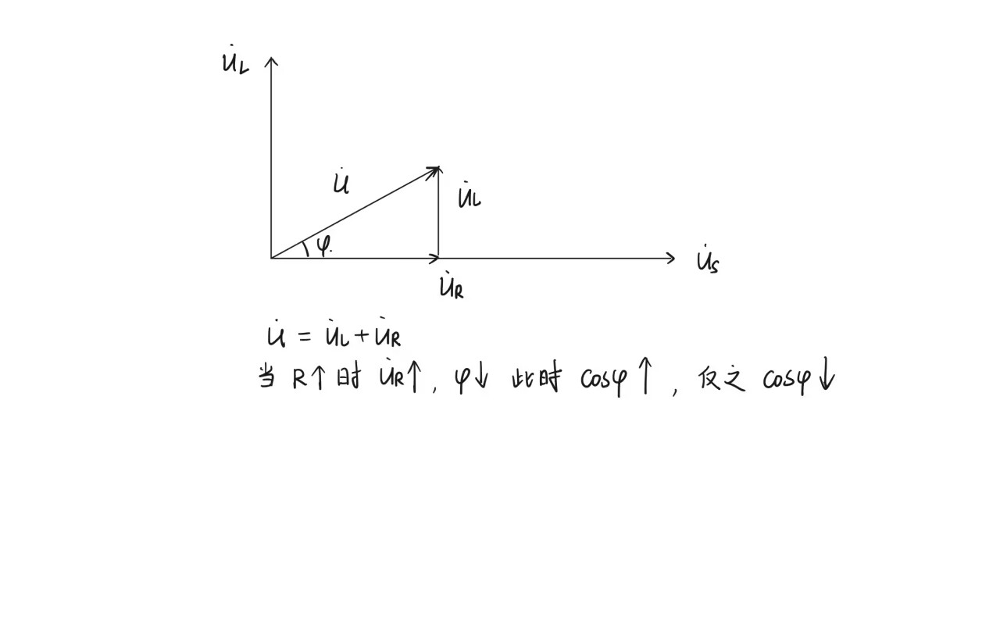

# 东南大学电工电子实验中心

## 实 验 报 告

课程名称：电路实验

第 4 次实验

实验名称：交流电路认识及参数测试

院（系）：电子科学与工程学院　专业：电子科学与技术

姓　　名：zhz　　学　　号：（已隐去）

实 验 室：204强电室　　实验组别：

同组人员：　　实验时间：2025年11月28日

---

## 一、实验目的

1. 了解交流电基础知识及电器设备使用操作方法；
2. 掌握电阻、电感、电容等单相交流电路参数测量方法，通过实验加深对阻抗概念的理解；
3. 掌握多功能表测量电压、电流、功率以及单相自耦调压器的正确使用方法；
4. 掌握功率因数的测量及其改变方法。

## 二、实验原理

**1. 理论计算：Z₁+Z₂（串联）、Z₁//Z₂（并联）时电路的性质**

Z₁=10Ω+L（114mH），Z₂=100Ω+C（10μF）

- 串联：Z'₁ = Z₁+Z₂ = 10+j11.4π+100-j1000/π = (110-j282.5)Ω → 呈**容性**
- 并联：Z'₂ = Z₁//Z₂ = (13.6+j38.6)Ω → 呈**感性**

**2. 功率因数**

功率因数 cosφ = 有功功率 P / 视在功率 S，反映电能利用效率。感性负载电流滞后电压，容性负载电流超前电压。

- 提高功率因数：并联电容补偿、高压输电、优化负载运行方式
- 降低功率因数：增加感性负载（插入铁芯）、减少并联补偿电容、减小电阻阻值

## 三、实验内容

### 1. 三电压表法测量电路参数

串联已知电阻 R=50Ω，Z₁=10Ω+L（理论值114mH），Z₂=100Ω+C（理论值10μF）。

| Z | U(V) | U1(V) | U2(V) | cosθ | Ur(V) | Ux(V) | r0(Ω) | L(mH) | C(μF) |
|---|------|-------|-------|------|-------|-------|-------|-------|-------|
| Z₁ | 60 | 32.6 | 31.5 | 0.75 | 23.63 | 20.84 | 36.24 | 101.74 | |
| Z₂ | 60 | 8.3 | 56.8 | 0.32 | 18.18 | 53.81 | 109.52 | | 9.82 |

分析：

- Z₁（RL电路）：测得 L=101.74mH，与理论值114mH相对误差10.75%；cosθ=0.75，呈感性，与预期一致。误差可能来自电感线圈内阻偏差和仪表读数波动。
- Z₂（RC电路）：测得 C=9.82μF，与理论值10μF相对误差仅1.8%；cosθ=0.32，容抗占主导，呈较强容性。测量结果较为准确。

### 2. 三表法（电压表、电流表、功率表）测量电路参数

| Z | I(A) | U(V) | P(W) | Z(Ω) | cosφ | r0(Ω) | X(Ω) | L(mH) | C(μF) |
|---|------|------|------|------|------|-------|------|-------|-------|
| Z₁ | 0.3 | 14.2 | 3.0 | 47.33 | 0.70 | 33.13 | 33.80 | 107.59 | |
| Z₂ | 0.3 | 99.9 | 9.7 | 333.00 | 0.32 | 106.56 | 315.49 | | 10.09 |
| Z₁+Z₂ | 0.3 | 95.6 | 13.2 | 318.67 | 0.46 | 146.59 | -282.95 | | 11.25 |
| Z₁//Z₂ | 0.3 | 14.9 | 3.5 | 49.67 | 0.78 | — | +31.08 | 98.93 | |

分析：

- 单独测量：Z₁ 测得 L=107.59mH（误差5.62%），Z₂ 测得 C=10.09μF（误差0.9%），比三电压表法更准确。三表法直接测功率，更直观反映能量转换关系。
- Z₁与Z₂串联：电抗为负值（-j282.95Ω，容性），与理论预测"串联后呈容性"一致。
- Z₁与Z₂并联：电抗为正值（+j31.08Ω，感性），与理论预测"并联后呈感性"一致。

### 3. 功率因数的改变

**（1）感性负载并联电容**

| 改变方法 | I(mA) | U(V) | P(W) | cosφ |
|----------|-------|------|------|------|
| 并联电容10μF | 274.1 | 14.3 | 3.3 | 0.842 |
| 并联电容24μF | 239.4 | 14.3 | 3.3 | 0.964 |

分析：并联电容后功率因数从0.70显著提高到0.842（10μF）乃至0.964（24μF，接近1）。并联电容提供容性无功电流，补偿了负载中的感性无功电流，总电流与电压相位差减小。

**（2）电感线圈插入铁芯**（保持电流0.3A）

| 改变方法 | I(A) | U(V) | P(W) | cosφ |
|----------|------|------|------|------|
| 铁芯插入1/3 | 0.3 | 27.9 | 3.1 | 0.370 |
| 铁芯全部插入 | 0.3 | 60.9 | 3.2 | 0.175 |

分析：电流不变，电压从14.2V升至27.9V/60.9V，说明阻抗 Z 增大（感抗 XL=ωL 增大，电感 L 增加）。cosφ=R/|Z|，R 基本不变，Z 增大 → 功率因数从0.70降至0.370乃至0.175。增加电感会显著减小功率因数。

**（3）改变Z₁中串联电阻阻值**（保持电流0.3A）

| 改变方法 | I(A) | U(V) | P(W) | cosφ |
|----------|------|------|------|------|
| Z₁中电阻值增大 | 0.3 | 16.4 | 3.9 | 0.793 |
| Z₁中电阻值减小 | 0.3 | 13.1 | 2.6 | 0.662 |

分析：感抗 XL 不变时，增大 R 使 R 在总阻抗中比重增加，阻抗角 φ 减小，cosφ 提高；减小 R 则 cosφ 降低。实验数据验证了这一理论。

## 四、思考题

**"并联电容"可以提高感性阻抗的功率因数，用矢量图分析并联的电容容量是否越大越好？**

不是越大越好。

感性负载电流 IL 滞后电压 U 一个角度 φ。并联电容后，电容电流 IC 超前电压90°，总电流 I=IL+IC（矢量相加）。随电容增大，IC 增大，总电流滞后电压的相位角 φ 减小，功率因数提高。但电容过大时，总电流超前电压，电路呈容性，功率因数反而下降。存在一个最优电容值使功率因数为1，超过后功率因数降低。

**电感线圈中插入铁棒，电感值会有怎样变化？**

插入铁棒后电感值增大。实验数据：铁芯部分插入，电压从14.2V升至27.9V，功率因数从0.70降至0.370；铁芯全部插入，电压升至60.9V，功率因数降至0.175。相同电流下电压升高说明感抗 XL=ωL 增大，因此电感 L 增大。铁棒作为铁磁材料增加了电感值。

**用矢量图分析Z₁中串联的电阻阻值变化对功率因数的影响。**

Z₁为RL串联电路，阻抗 Z=R+jωL。电压 U 由电阻电压 UR 和电感电压 UL 合成。当 R 增大时，UR 增大，总电压与电流的相位差 φ 减小，cosφ 增大；R 减小时，φ 增大，cosφ 减小。实验验证：电阻增大时功率因数从0.70升至0.793，减小时降至0.662。

## 五、实验总结

**实验误差分析**：

- 仪器误差：电压表、电流表、功率表精度限制及读数误差。
- 操作误差：调压器调节不精确、接线接触电阻影响。
- 理论误差：元件参数（L、C）与理论值偏差、频率波动影响计算。

**出现的问题及解决方法**：

1. 三电压表法中电压读数不稳定 → 检查接线牢固性，等待读数稳定后记录。
2. 并联电容时电流变化不明显 → 逐步增加电容值，避免过补偿。
3. 铁芯插入后电流难以保持0.3A → 缓慢调节调压器，微调电压使电流恒定。

**收获体会**：

通过实验加深了对交流电路阻抗、功率因数的理解；掌握了三电压表法和三表法测量电路参数的方法；学会了通过并联电容、改变电感、调整电阻来改变功率因数；思考题分析提升了矢量图应用能力和理论联系实际的能力。
