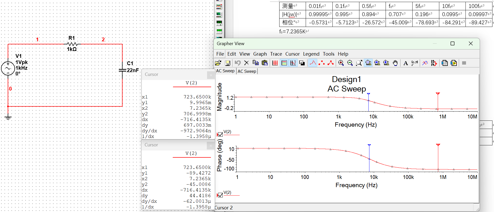
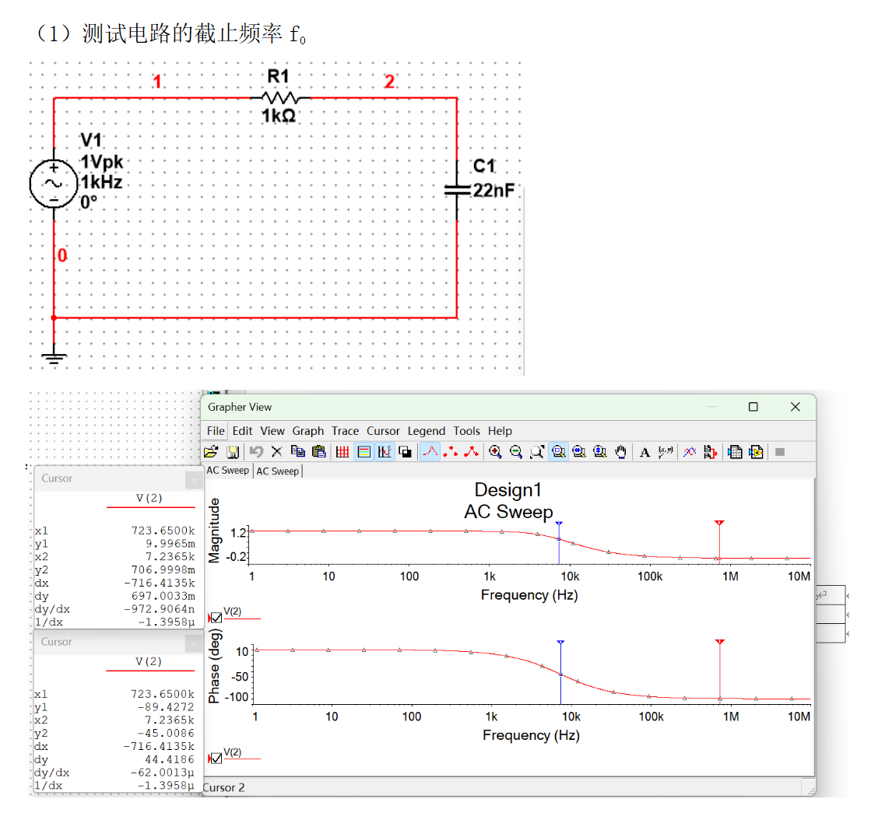
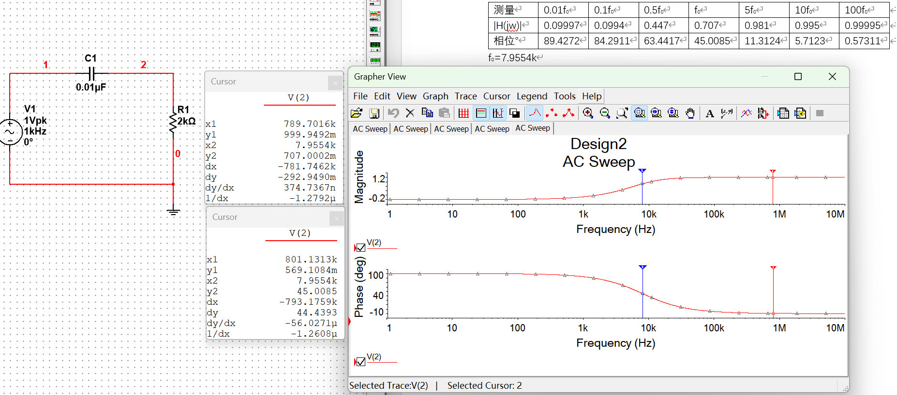
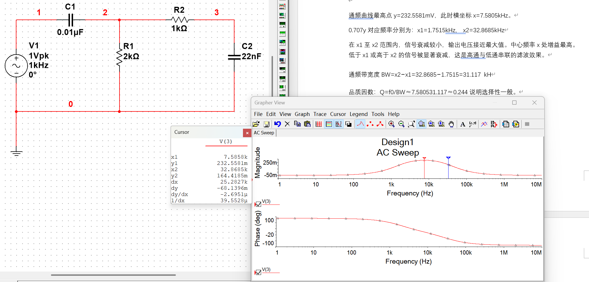
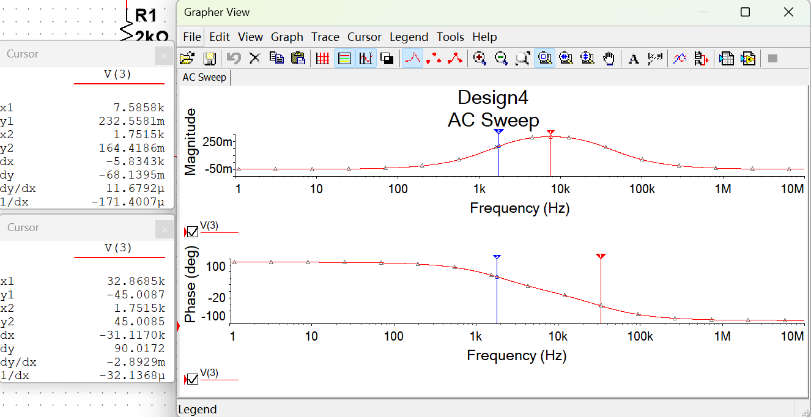
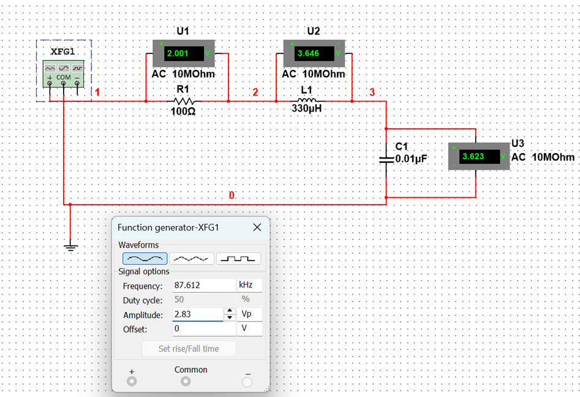
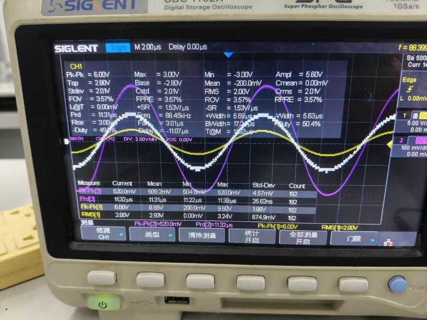
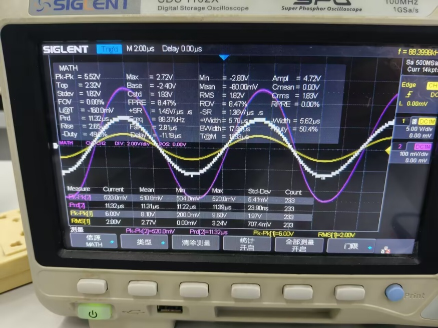
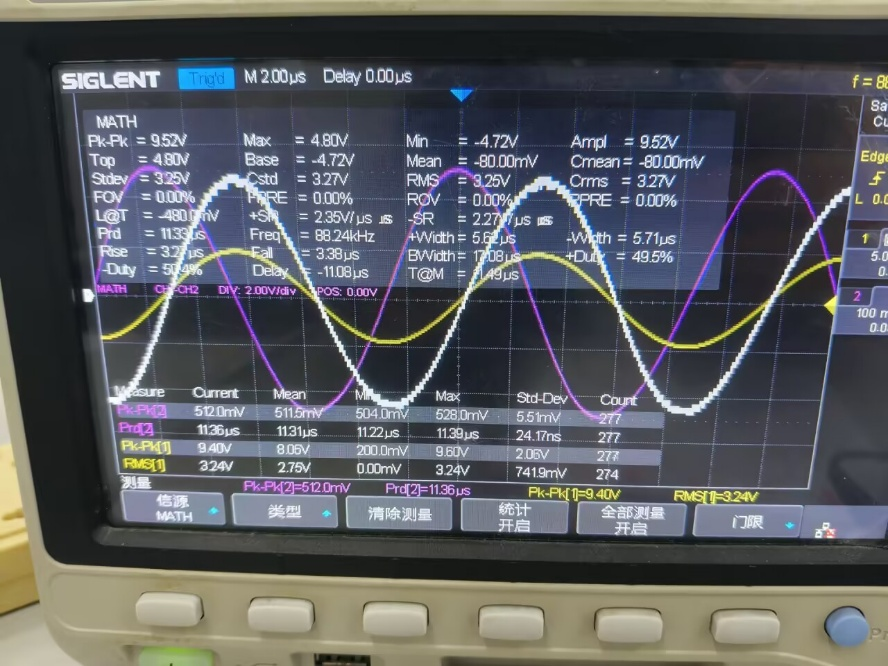
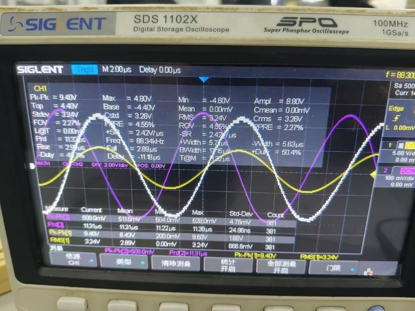

# 东南大学电工电子实验中心

## 实 验 报 告

课程名称：电路实验

第 6 次实验

实验名称：双端口网络频率特性测试及谐振电路分析

院（系）：电子科学与工程学院　专业：电子科学与技术

姓　　名：zhz　　学　　号：（已隐去）

实 验 室：403室　　实验组别：

同组人员：　　实验时间：2025年12月18日

---

## 一、实验目的

1. 掌握低通、高通、带通电路、带阻电路的频率特性；
2. 应用 Multisim 软件测试低通、高通、带通电路、带阻电路及有关参数；
3. 掌握 Multisim 软件中的交流分析功能测试电路的频率特性；
4. 掌握电路谐振及其特征；
5. 掌握 RLC 串联谐振现象观察、测量方法。

## 二、实验原理

**1. 一阶 RC 低通电路频率特性（Multisim 交流分析）**

测试电路的截止频率 f₀：

分别测试 0.01f₀、0.1f₀、0.5f₀、f₀、5f₀、10f₀、100f₀ 各点对应的 |H(jω)| 和 φ 值：

| 频率 | 0.01f₀ | 0.1f₀ | 0.5f₀ | f₀ | 5f₀ | 10f₀ | 100f₀ |
|------|--------|-------|-------|----|-----|------|-------|
| |H(jω)| | 0.99995 | 0.995 | 0.894 | 0.707 | 0.196 | 0.0995 | 0.09997 |
| φ(°) | -0.5731 | -5.7123 | -26.572 | -45.009 | -78.693 | -84.291 | -89.427 |

**2. 一阶高通电路设计**

要求 f₀ 在 8kHz 左右。电容只有 0.01μF、22nF、3.3nF 三种，选用 C=0.01μF，则：

R = 1/(2π×8×10³×10⁻⁸) ≈ 1989Ω ≈ 2kΩ

器件清单中有 2kΩ 电阻，故选 R=2kΩ、C=0.01μF，理论截止频率 f₀ ≈ 1/(2π×2000×10⁻⁸) ≈ 7.96kHz。输出信号取自电阻两端：

| 频率 | 0.01f₀ | 0.1f₀ | 0.5f₀ | f₀ | 5f₀ | 10f₀ | 100f₀ |
|------|--------|-------|-------|----|-----|------|-------|
| |H(jω)| | 0.09997 | 0.0994 | 0.447 | 0.707 | 0.981 | 0.995 | 0.99995 |
| φ(°) | 89.427 | 84.291 | 63.442 | 45.006 | 11.312 | 5.712 | 0.57311 |

**3. RLC 串联电路谐振频率理论计算**

R=100Ω，L=330μH，C=0.01μF。谐振时虚部为零，故 f₀=1/(2π√(LC))≈87.612kHz。

## 三、实验内容

**1-2. 见实验原理**

**3. 高通、低通电路串联，用 Multisim 测试频率特性**

说明分析：通频曲线最高点 y=232.5581mV，此时 f₀=7.5805kHz。0.707Y 对应：下限截止频率 f₁=1.7515kHz（相位角 45.0085°），上限截止频率 f₂=32.8685kHz（相位角 -45.0087°）。在 f₁ 至 f₂ 范围内信号衰减较小，输出电压接近最大值；低于 f₁ 或高于 f₂ 的信号被显著衰减——这就是高通与低通串联的滤波效果。

通频带宽度 BW = f₂-f₁ = 32.8685-1.7515 = 31.117kHz

品质因数 Q = f₀/BW ≈ 7.5805/31.117 ≈ 0.244，选择性一般。

**4. RLC 串联谐振电路测量**

（1）R=100Ω，L=330μH，C=0.01μF，激励电压 2V RMS。

（2）Multisim 仿真，显示谐振时每个元器件上的电压值：

（3）如何利用 RLC 谐振电路实现带通及带阻：

- 实现带通：从电阻两端输出电压，谐振时输出电压最大，频率偏离时输出减小，形成带通特性。
- 实现带阻：从电感和电容串联组合的两端输出电压（谐振时两者相位相反互相抵消，输出电压最小），形成带阻特性。

（4）搭实物电路，再现谐振现象，测量谐振频率，记录 UR、UL、UC 值及波形。

谐振点测量：频率扫描 80kHz–100kHz，示波器 CH1/CH2 及 Math=|CH1-CH2|，保持信号源输出 2V RMS。先粗测确定谐振范围在 87.6k–90k 之间：

| f₀/Hz | 80k | 83k | 85k | 87.6k | 90k | 92k | 95k | 100k |
|-------|-----|-----|-----|-------|-----|-----|-----|------|
| UR/V | 1.75 | 1.78 | 1.79 | 1.81 | 1.80 | 1.81 | 1.82 | 1.82 |
| UL/V | 2.80 | 2.98 | 3.09 | 3.24 | 3.36 | 3.35 | 3.46 | 3.64 |
| UC/V | 3.41 | 3.36 | 3.33 | 3.29 | 3.24 | 3.09 | 3.00 | 2.85 |

精细测量：

| f₀/Hz | 87.6k | 88k | 88.2k | 88.4k | 88.5k | 89k | 90k |
|-------|-------|-----|-------|-------|-------|-----|-----|
| UR/V | 1.81 | 1.81 | 1.81 | 1.82 | 1.82 | 1.81 | 1.80 |
| UL/V | 3.24 | 3.23 | 3.24 | 3.25 | 3.26 | 3.26 | 3.36 |
| UC/V | 3.29 | 3.25 | 3.25 | 3.25 | 3.24 | 3.21 | 3.24 |

谐振频率 f≈88.4kHz。谐振时波形（CH1 黄色，CH2 紫色，MATH 白色）：

谐振时电阻电压测量：Math 波形与信号源相位相同。

谐振时电感电压 UL=-(CH1-CH2)=MATH，MATH 与电容电压 UC=CH1 同相位，故电感电压 UL 与电容电压相位相反。

（5）仿真与实物结果对比分析：

仿真理论谐振频率 f=87.612kHz，实测 f=88.4kHz，相对误差 (88.4-87.612)/87.612=0.899%，在合理范围内。实测品质因数 Q=UC/U=3.25/2=1.63，低于理论值 1.82；实测谐振时电阻电压 UR=1.82V（略低于理论 2V），电感电容电压 UL、UC 均为 3.25V（低于理论 3.63V）。差异主要源于信号源内阻分压、电感电容元件实际损耗电阻，以及周围电子产品电磁干扰。整体趋势与理论预测一致。

## 四、实验总结

本次实验系统完成了对一阶 RC 电路、RC 滤波器串联网络及 RLC 串联谐振电路的频率特性测试与分析。通过 Multisim 仿真与实物电路相结合，验证了低通、高通滤波器特性，并成功将两者串联实现中心频率约 7.58kHz、带宽约 31.1kHz 的带通滤波功能。RLC 串联谐振实验中，理论谐振频率 87.61kHz，实测 88.4kHz，相对误差 0.9%；实测品质因数 Q 由理论 1.82 降至 1.63，主要归因于信号源内阻、元件实际损耗及外界影响。实验中通过频率扫描测量与波形对比，掌握了交流分析、谐振点判定及参数测量方法，深化了对电路频率响应、谐振条件及非理想因素影响的理解，也体会到理论联系实际、仿真与实验相互印证的重要性。
