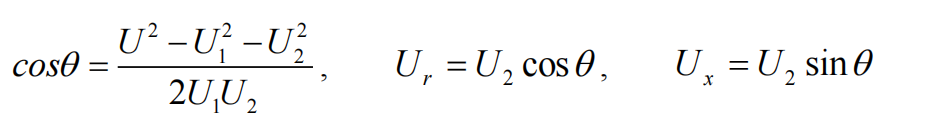
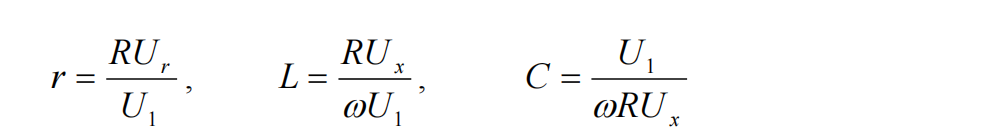
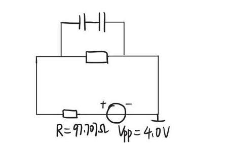

# 东南大学电工电子实验中心

## 实 验 报 告

课程名称：电路实验

第 8 次实验

实验名称：黑箱元件判别及参数测试

院（系）：电子科学与工程学院　专业：电子科学与技术

姓　　名：zhz　　学　　号：（已隐去）

实 验 室：403室　　实验组别：

同组人员：　　实验时间：2025年12月26日

---

## 一、实验目的

1. 运用欧姆定律和元件的阻抗特性解决实际问题；
2. 学会根据需要选择激励源的类型、设定频率的高低，简化测量过程、提高测量精度；
3. 尝试从分析任务要求着手，应用已经学习过的知识寻找解决问题的方法，体验"分析任务—调查研究—设计电路—构建平台—实验测试—总结分析"的科学研究方法。

## 二、实验原理

黑箱电路由三个元件构成 Y/△ 网络结构。三个元件分别是电阻、电容、电感中的单一元件，且互不相同。采用实验测量的方法，通过测试判断"Y"、"△"型网络中各元件的性质并计算参数。

**黑箱元件连接方式判断**：先用万用表测量各端口间的电阻与电容值并记录，列举所有可能的元件搭配与连接方式，再通过设计信号源激励方式排除不符合要求的连接方式，最终确定连接方式。

**元件判断及参数计算方法**：

1. **三电压法测交流阻抗**：将被测元件 Z 与已知电阻 R 串联，通入已知频率的正弦交流信号，用电压表分别测出电压 U、U₁ 和 U₂，根据三个电压向量构成的三角形矢量图求出元件阻抗参数。

2. **RLC 串联电压相位法**：在 RLC 电路中，电压与电流一般不同相。频率从低到高变化时，元件电压相位依次出现超前、同相、落后，据此可判断电路元件特性。

## 三、实验内容

### 1. 黑箱元件连接方式与元件判断

将万用表调至电阻测量模式，测量黑箱 1-2、1-3、2-3 端口：

| R(1-2) | R(1-3) | R(2-3) |
|--------|--------|--------|
| ∞ | ∞ | 0.99769kΩ |

将万用表调至电容测量模式：

| C(1-2) | C(1-3) | C(2-3) |
|--------|--------|--------|
| 96.2nF | 96.5nF | 0.0012nF |

据此枚举所有可能的连接方式（至少含一个电阻）：

| 连接方式 | Y-1 | Y-2 | Y-3 | △-4 |
|----------|-----|-----|-----|------|
| 1端 | 电容 | 电容 | 电容 | 2-3端：电阻 |
| 2端 | 电阻 | 电阻 | 电感 | 1-3端：电容 |
| 3端 | 电阻 | 电感 | 电阻 | 1-2端：电容 |

**检验第4种（△型）假设**：已知黑箱元件标称值范围——电阻 100Ω~1000Ω，电容 0.001μF~0.22μF，电感 0.047mH~0.47mH。设置信号源峰峰值 4.0V，保护电阻 97.707Ω，调节信号源频率至高频区（100kHz–1MHz，此时电容阻抗极小、电感阻抗逐渐增大）：

| 频率 | 保护电阻峰峰值 | 信号源输出峰峰值 | 相位差（阻抗与保护电阻） |
|------|----------------|------------------|--------------------------|
| 100kHz | 600mV | 3.80V | 接近 0° |
| 1000kHz | 600mV | 3.74V | 接近 0° |

此时黑箱总阻抗约在 500~1000Ω，与高频区并联电容阻抗极小的预期矛盾，故**排除唯一的△型连接方式**。

**确定 Y 型元件布局**：将黑箱 1-3 端接入电路，保护电阻 97.707Ω，信号源频率从 1kHz 扫至 60kHz，记录黑箱阻抗超前电压源的相位 φ：

| f | 1kHz | 20kHz | 25kHz | 30kHz | 40kHz | 50kHz | 60kHz |
|---|------|-------|-------|-------|-------|-------|-------|
| φ | 接近 0° | -72.42° | -33.50° | +70.09° | +59.76° | +46.8° | +35.64° |

相位随频率剧烈变化（低频接近 0°→中频负大角度→高频正大角度），说明该支路为电容与电感的串联组合。由于是 Y 型连接，故：**1端接电容，2端接电阻，3端接电感**，为 RLC Y 型连接。

电感存在的验证：将 2-3 端口接入电路，保护电阻 980.67Ω，信号源峰峰值 4V，频率 3MHz，波形显示阻抗相位明显落后于信号源，故 2-3 端口一定存在电感。

### 2. 元件参数计算

**（1）电容值测量**：将 1-2 端口接入电路，保护电阻 97.707Ω，信号源激励峰峰值 4V，在 1~3kHz 范围内用三电压表法测量：

| f | U(V) | U₁(V) | U₂(V) | cosφ | Ur | Ux | r₀(Ω) | C(nF) |
|---|------|-------|-------|------|----|----|-------|-------|
| 1.5kHz | 1.32 | 0.346 | 1.06 | 0.6804 | 0.7212 | 0.7768 | 700.94 | 94.65 |
| 2kHz | 1.37 | 0.124 | 1.29 | 0.6171 | 0.7966 | 1.0151 | 627.263 | 99.47 |

低频区电容阻抗很大，电容测量准确而电阻误差大，故舍去 R 值，取电容平均值：

C = (94.65+99.47)/2 = **97.06nF**

对应波形图：

**（2）电感值测量**：将 2-3 端口接入电路，保护电阻 527.07Ω，信号源激励峰峰值 4V，在 200~300kHz 范围内用三电压表法测量（此频段电阻与电感测量精度最佳）：

| f | U(V) | U₁(V) | U₂(V) | cosφ | Ur | Ux | r₀(Ω) | L(μH) |
|---|------|-------|-------|------|----|----|-------|-------|
| 200kHz | 1.39 | 0.439 | 0.984 | 0.8605 | 0.8467 | 0.5013 | 1016.56 | 478.95 |
| 250kHz | 1.39 | 0.403 | 1.02 | 0.8871 | 0.9048 | 0.4708 | 1183.36 | 391.99 |
| 300kHz | 1.39 | 0.379 | 1.05 | 0.8618 | 0.9049 | 0.5326 | 1258.43 | 392.94 |

200kHz 时电阻值更符合原始数据，电感取 **478.95μH**；电阻阻值远大于电感内阻，直接采用万用表测得值 R(2-3)=**997.69Ω**。

测量电路波形：

## 四、总结与收获

### 1. 实验中遇到的主要问题与解决方式

本次黑箱实验的核心挑战在于，仅能通过外部端口的有限测量推断内部不可见的结构与元件参数。

**（1）各端口对应元件类型（R/L/C）的识别**

确定 Y 型连接后，需明确三个端子各自的元件类型。采用**扫频相位观测法**：将疑似含电感电容的端口（如 1-3）接入电路，从 1kHz 向 60kHz 扫频，测量阻抗两端电压相对电流的相位差。观察到相位剧烈变化（低频接近 0°→中频负大角度→高频正大角度），提示该支路为电容与电感串联；再结合纯电阻支路（2-3 端口）相位验证（始终接近 0°），最终通过逻辑推理唯一确定布局：1端电容、2端电阻、3端电感。

**（2）测量误差与数据取舍**

不同频率下同一元件的计算结果存在波动，需要取舍。解决方式是建立**物理意义指导下的数据取舍原则**：低频测电容时，电阻计算值偏差大（其贡献被高容抗淹没），果断舍去不可靠的电阻数据，只采纳稳定的电容结果；测电感时取多个频率点的平均值或最接近理论预期的值，并参考独立测量的电阻值做合理性判断。

### 2. 实验收获与体会

1. **深化了对电路元件频率特性的理解**：在交流电路中，"测量频率"不是任意选择的参数，而是决定测量成败与精度的关键。必须选择元件阻抗特性显著、易于区分的频率点。
2. **掌握了"黑箱"问题的系统分析方法**：万用表初测→假设建模→实验设计→逻辑推理→精确测量与参数提取。用高频测试否定△型连接的环节，让我理解了判决性实验的重要性。
3. **提升了综合运用仪器和实验方法的能力**：熟练掌握信号发生器、示波器配合使用，成功应用三电压表法；认识到实验报告中的"原始数据"需要基于物理原理的批判性分析，合理的取舍有时更重要。

这次实验把课本上的频率特性、阻抗知识真正用起来，还是很有挑战性的。
