# 实验五 FPGA小系统设计

姓名：zhz　　学号：（已隐去）

> 注：报告原文未标注实验日期。

---

实验五 FPGA小系统设计

姓名：zhz  学号：（已隐去）

实验目标

1. 综合前面所学的各项内容。

2. 了解掌握数字系统设计的流程和方法。

3. 掌握复杂电路连接和调试技能。

实验内容

1. 实验基础部分

设计一个简易计算器，它具有下列运算功能：

(1) 一位十进制数的相加；

(2) 一位十进制数的相减；

(3) 数值和运算符用4×4键盘输入，其中A为“+”，B为“-”，C为“×”，E为“=”

(4) 数值用数码管以十进制形式显示，以加法为例，初始时显示全“0”，先输入被加数，再输入运算符，按下运算符键后，数码管显示全“0”，再输入加数，方法和前面一样，最后按下“=”，数码管显示运算结果

2. 实验扩展部分

(1) 一位十进制数的相乘，必须采用串行乘法实现；

(2) 其他自选功能。

实验仪器

FPGA实验板及键盘外设。

QuartusⅡ

设计思路

采用自顶向下思路首先划分实验要求对实验进行模块划分，将计算器划分为键盘输入模块、运算控制模块、算术运算模块、显示模块，各模块由统一时钟信号控制工作。模块之间逻辑图表述为：

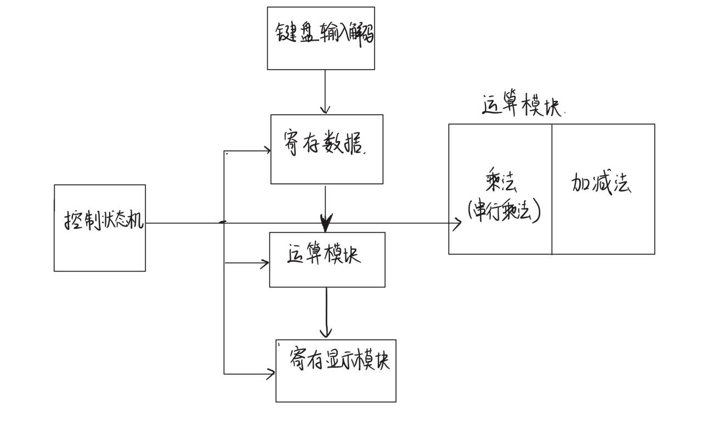

由于实验室提供键盘输入模块的封装键盘扫描，我将先从运算控制模块以及算术运算模块进行设计：

首先将键盘输入数据分配四个输入引脚A[3..0]，键盘输入KN：0~9数字键，KA：加号键，KB：减号键，KC：乘号键，KE：等号键；符号锁存信号为KA1（加号）、KB1(减号)、KC1（乘号）、Z(串行乘法器完成计算时的信号)；RA：被加数寄存器，RB：加数寄存器，RP：运算符寄存器，SA：低位显示寄存器，SB：高位显示寄存器；寄存器控制信号分别为RAR（清零）、RAS（置数）、RBR（清零）、RBS（置数）、RPS（置数）、SAR（清零）、SAS（置数）、SBR（清零）、SBS（置数）。将输出分配8个引脚，分别为High[3..0]、Low[3..0]。

考虑到串行乘法器需要四个时钟周期才能完成计算，并且受到主状态机的控制，那么根据系统运算模块的逻辑变化画出状态转换图为：

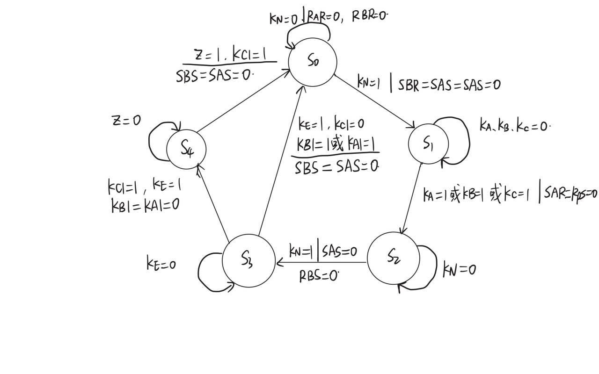

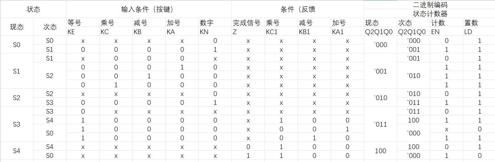

将S0,S1,S2,S3,S4用二进制编码编码为000，001，010，011，100，根据状态转换图可以写出状态转换真值表为：

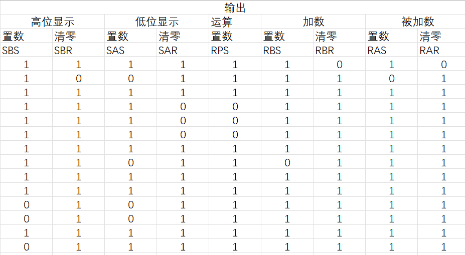

使用1个74161控制主控模块的状态转移，写出状态转换方程为：

在此主状态控制模块，先只涉及被加数与加数的锁存模块以及状态转换模块，后续对乘法和加减仿真后在添加显示模块。

据此写出每个输出反馈信号的逻辑表达式，在QuartusⅡ中根据逻辑表达式画出主状态机（主控制模块+BCD加减法运算与输出）原理图为：

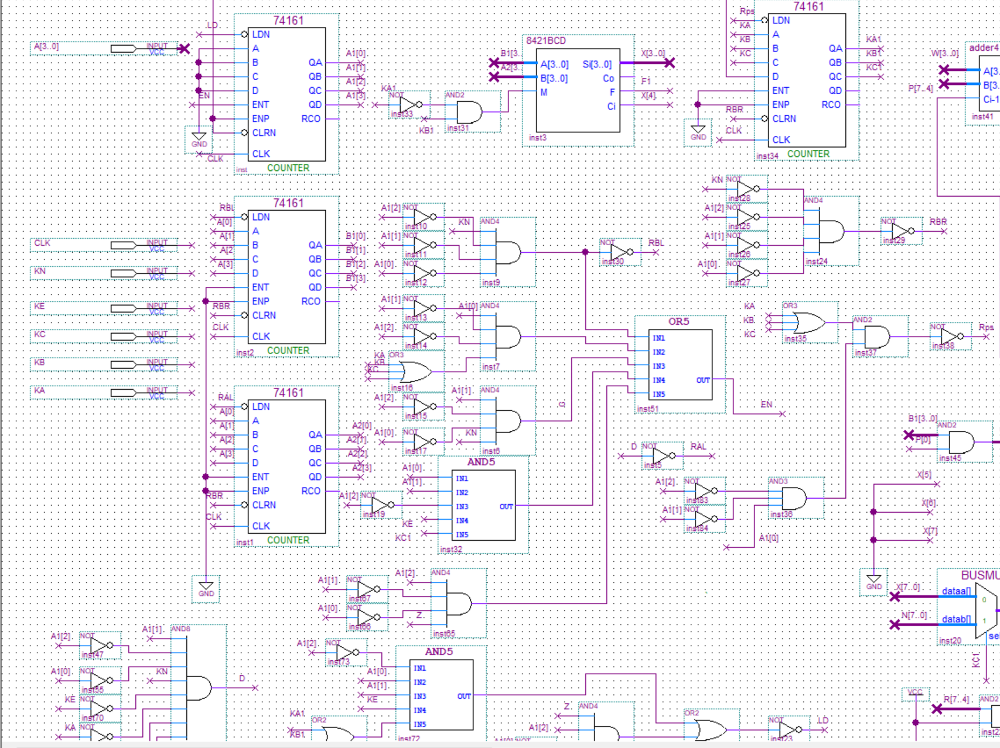

由此已完成了BCD加减法的计算与输出，将输出的进位扩展为四位BCD码编译为X[7..4]，加减运算得出的编译为X[3..0]，将X[7..0] 和乘法器输出的8位二进制校正码N[7..0]一起送到数选器BUSMUX中，这一次的数选部分原理图为：

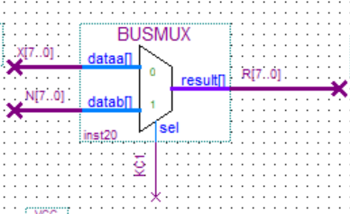

然后开始设计四位串行乘法器：定义EN：启动；Z：计数到3；P[0]：乘数最低位；A：被乘数寄存器，AS(置数)；P：部分积寄存器，PS(置数)，PR(清零)；Q：移位寄存器，QS（置数），QR（清零）；C：移位计数器，CR(清零)，CE(计数)。

将S0,S1用二进制编码分别编码为0,1，画出状态转换图为：

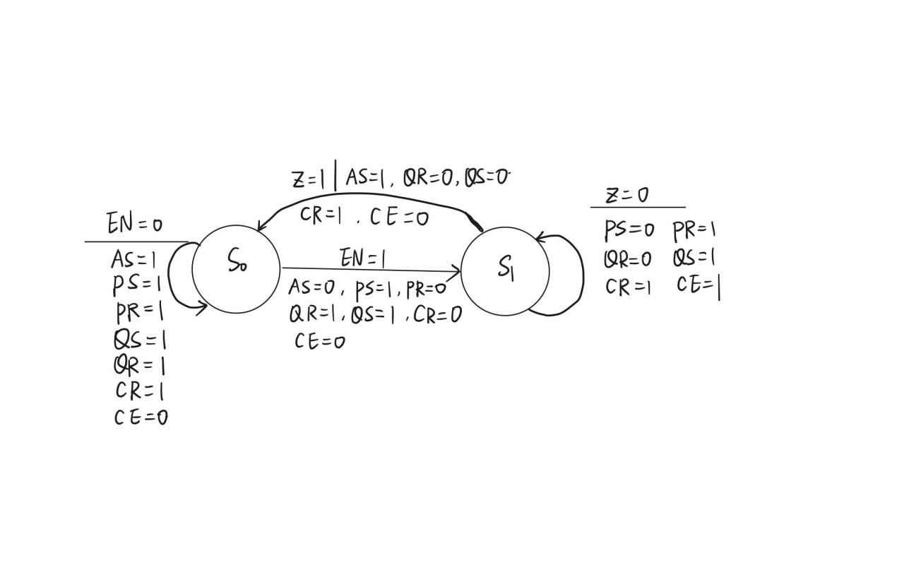

根据状态转换图画出状态转换真值表为：

使用一个D触发器，控制乘法器的状态转换，写出状态方程为：

其中EN信号表达式为EN=KEKC1; 作用为激活乘法器计算的使能信号，高电平有效。下面设计串行乘法器的部分积计算模块，电路原理图如图所示：

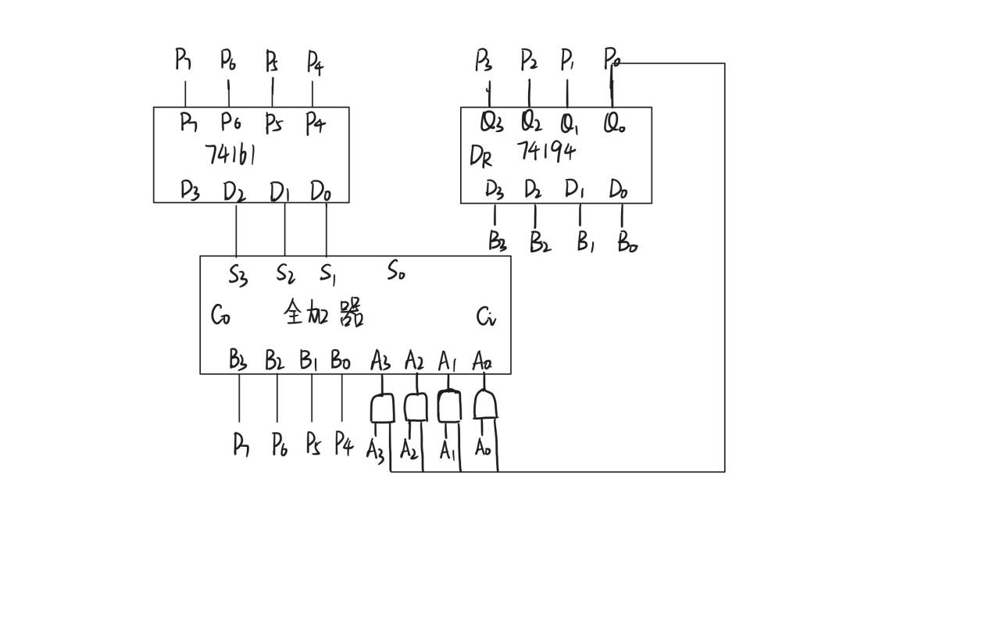

根据状态转换真值表写出逻辑表达式，在QuartusⅡ中画出乘法器的计数器模块和乘法器状态机及计算模块为：

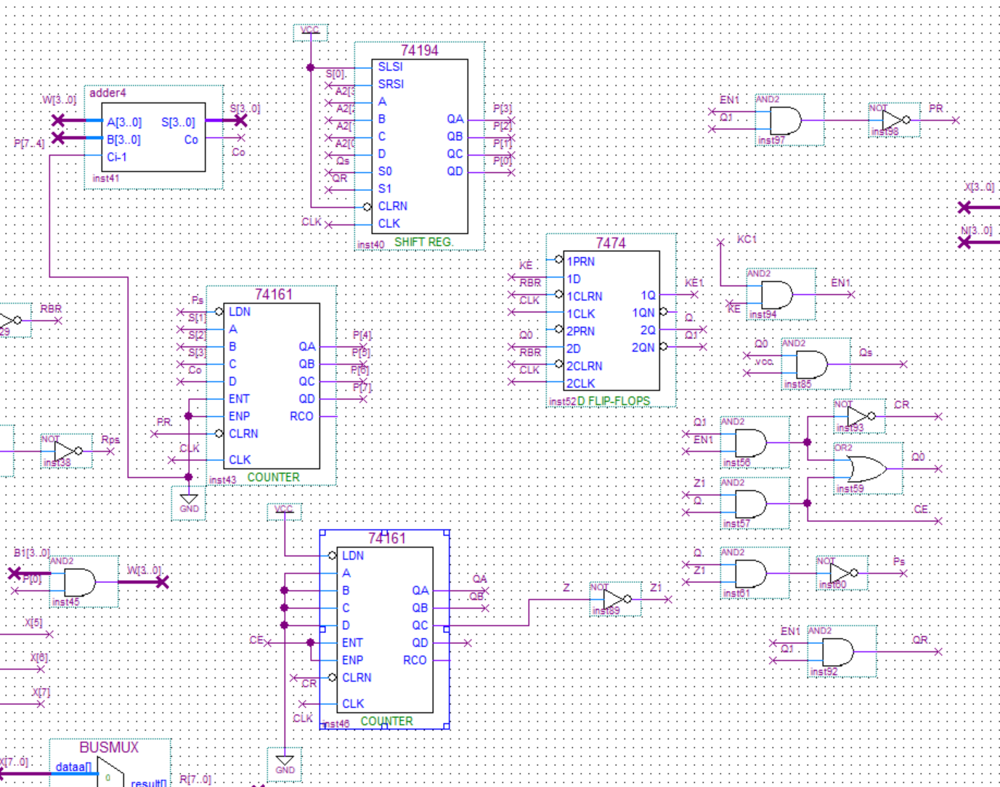

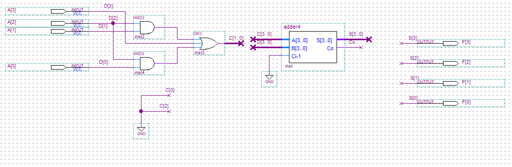

由于产生的八位串行码为二进制码，需要校正为对应数字的8421BCD码，下面考虑设计乘法器的校正模块：采取低四位表示的数字超过5则加3的校正逻辑，先设计小模块并封装，再通过八位校正的移位逻辑通过小模块级联的方式实现全部校正。8421BCD校正模块的原理图为：

8位二进制乘法输出结果的校正级联原理图为：

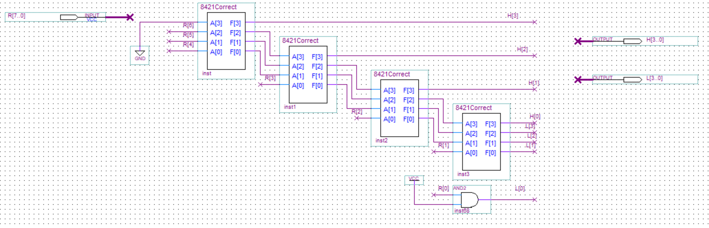

此原理图的仿真波形图为：

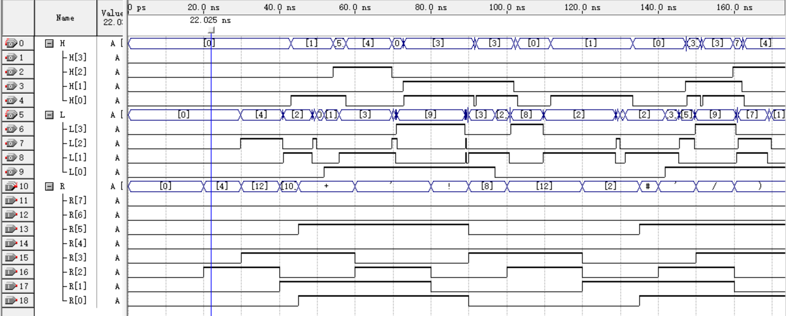

将此模块封装并添加到计算模块中，即可实现校正功能。对其进行仿真，波形图为：

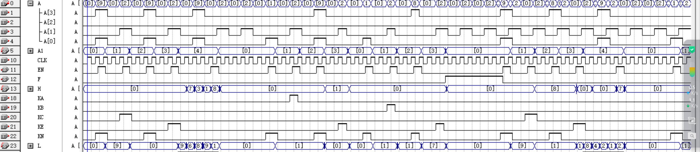

考虑加减计算以及符号位的产生，使用之前实验做的BCD加减器，将进位扩展为四位和低位四位输出组成两位8421BCD码，可直接接入到显示器寄存模块。BCD加减器作为一个已封装过的元件，当M=0时为加法运算，M=1时为减法运算，F为符号位，原理图为：

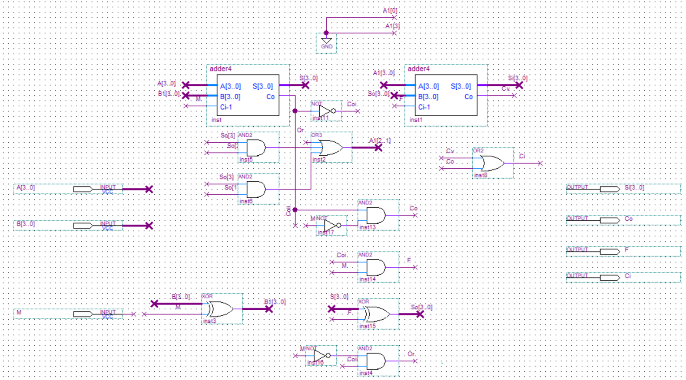

将其添加到原理图中，进行仿真实验，观察仿真波形图：

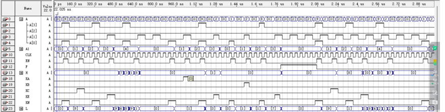

将加减和乘法的输出经过选择部分选择输送到显示模块，这一部分的选择原理图为：

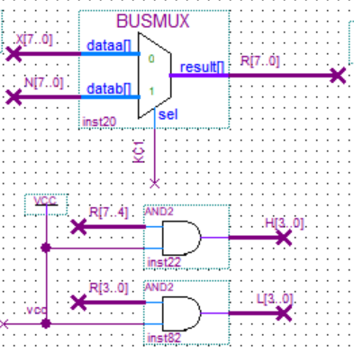

最后设计显示模块的电路图，根据主状态控制逻辑写出相对应的逻辑表达式，使用三个74161作为锁存器，分别锁存低位输出、高位输出以及符号位的锁存，高位输出与符号位锁存使用统一逻辑直接接到锁存器中，低位输出由于需要满足 “初始时显示全“0”，先输入被加数，再输入运算符，按下运算符键后，数码管显示全“0”，再输入加数，方法和前面一样，最后按下“=”，数码管显示运算结果” 需要对低位输出做出选择，其原理图设计如下：

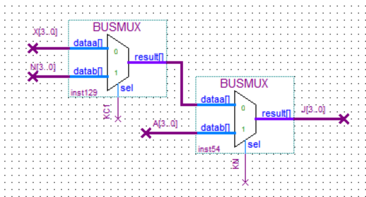

显示模块受到主状态机的调控，根据状态转换真值表写出反馈置数清零信号的逻辑表达式为：

据此画出逻辑电路图为：

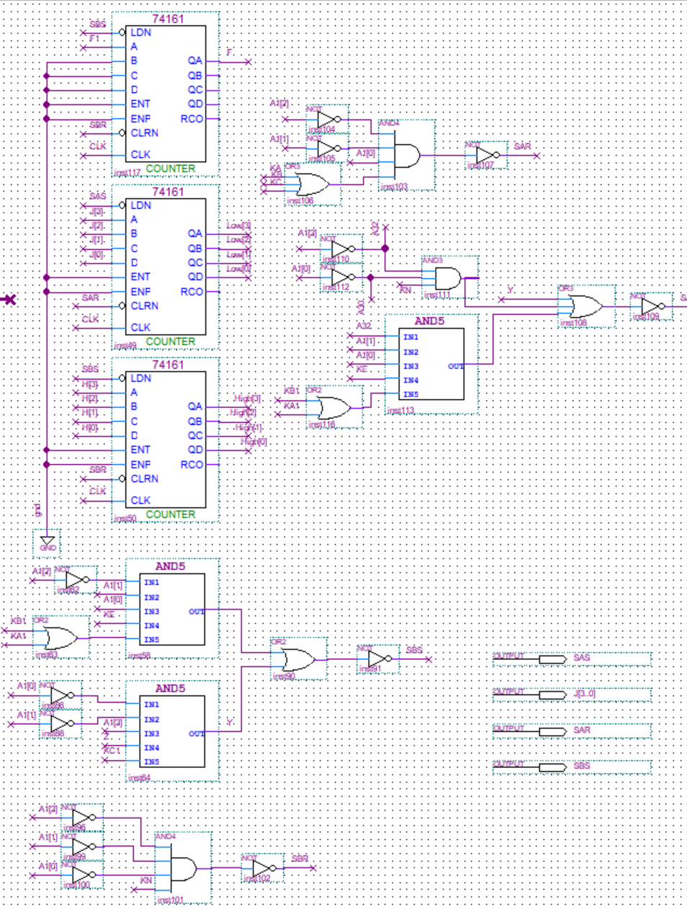

之后对整个电路计算模块进行仿真，乘法(结果为81)，加法(结果18)波形图为：

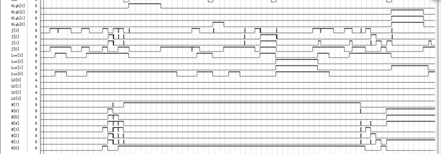

将设计完成后的计算模块封装，与键盘模块与脉冲处理模块以及显示模块连接，其中键盘模块仿真结果为：

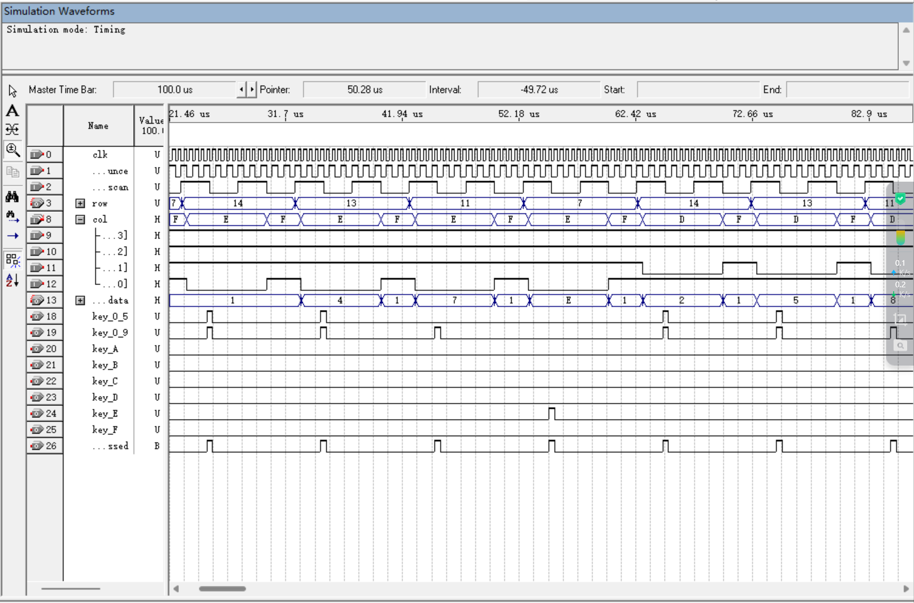

连接后的电路图为：

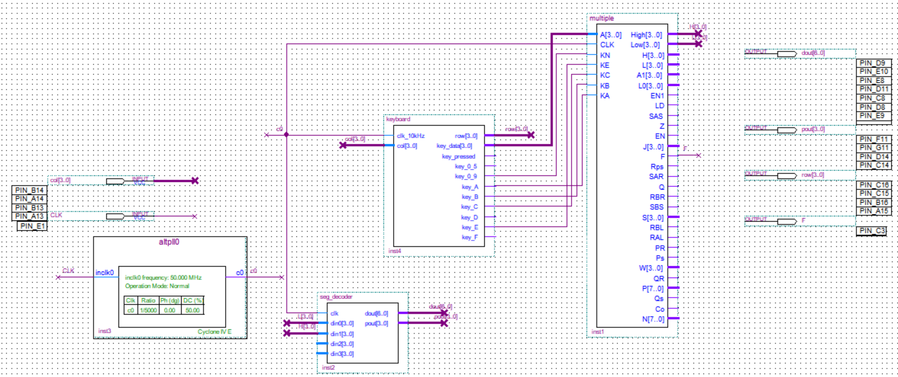

下载到实验板上，经过调试能正确完成加减乘三种运算，且均符合调试标准。

实验中遇到的问题与解决方法

在本次计算器设计实验中，我遇到了几个关键的设计与实现问题，现将问题描述、原因分析及解决方法总结如下：

1、BUSMUX使用错误

由于是第一次使用，并不熟悉它的使用规则，未设置数据宽度使得编译时发生崩溃。后来经过查阅网上资料后学会了如何设置数据宽度后来成功编译。

2、乘法器设计中移位寄存器使用错误。

实现乘法运算时，在实际画图时，误将移位寄存器设计为左移。这导致移位操作与数据处理不符合，乘法过程无法按预期步骤进行，计算结果错误。错误根源在于混淆了条件触发移位的设计思路。正确的乘法过程应在特定条件下才执行移位与加法，而我最初的设计却让移位在相反方向执行，破坏了算法的逻辑。

3、计数器Z需要计数到四，延迟一个时钟周期。

设计中计数器 z 负责控制乘法迭代次数，理论上应计数到4（对应4位乘法）后停止。但初始设计中，计数器后设计到3，而初始值我设置的1，导致状态机少运行一个周期，移位不完全，输出结果滞后且引发后续时序错误。

4、数选器中没有直接将输入数据连接到数选器上，而是先锁存，这样到达第二个数和输出数时，一个时钟周期内无法完成数的输出。

在数据选择器（MUX）部分，我没有直接将输入数据连接到选择器的输入端，而是先将输入数据用寄存器锁存，再送入选择器。这增加了数据路径上的延迟，导致在同一个时钟周期内，当选择信号变化后，被选择的第二个数据无法及时通过MUX输出，从而造成输出结果错误或延迟。

最终，通过逐一解决上述问题，计算器功能得以正确实现，且能在时钟频率下稳定工作。这让我认识到在数字电路设计中，不仅要考虑功能正确性，还必须深入分析时序关系，确保数据流与控制流的严格同步。

实验总结

通过本次“FPGA小系统设计”实验，我完成了一个具备加、减、乘运算功能的简易计算器系统。实验不仅巩固了前期所学的数字逻辑与硬件描述语言知识，更重要的是让我亲身体验了从需求分析、模块划分、电路设计、功能仿真到系统集成的完整数字系统开发流程。

在设计过程中，我采用自顶向下的方法，将系统地划分为键盘输入、运算控制、算术运算（BCD加减器与串行乘法器）及显示四大模块。这种模块化思想极大地降低了设计复杂度，使得各单元可以独立设计、仿真与调试，最后通过明确的数据与控制接口进行整合，最终实现了预定功能。

本次实验的核心挑战与收获集中在 “串行乘法器的设计与集成” 以及 “多模块间的时序协同” 两方面。乘法器设计让我深刻理解了时序逻辑在控制数据流中的核心作用，例如通过状态机精确控制“乘数移位”与“部分积累加”的节拍。而在集成阶段遇到的计数器终止条件偏差、数据选择路径延迟等问题，则警示我在数字系统设计中时序的精确匹配与数据的同步传递才是系统稳定可靠运行的关键。通过分析仿真波形、修正控制逻辑和优化数据路径，我逐步解决了这些问题。

此外，将二进制乘积结果转换为8421BCD码的校正电路设计，以及键盘输入、运算过程与数码管显示三者间的状态联动控制，都锻炼了我的综合能力。

总而言之，本实验使我认识到，一个成功的数字系统，是严谨的规划和细致的时序调试结合的产物。这次经历为我设计更复杂的数字集成电路打下了坚实的基础。

| 现态 | 次态 | EN | Z | P[0] | AS | PS | PR | QR | QS | CR | CE |
| S0 | S0 | 0 | X | X | 1 | 1 | 1 | 0 | 0 | 1 | 0 |
| S0 | S1 | 1 | X | X | 0 | 1 | 0 | 1 | 1 | 0 | 0 |
| S1 | S1 | X | 0 | 0 | 1 | 0 | 1 | 0 | 1 | 1 | 1 |
| S1 | S1 | X | 0 | 1 | 1 | 0 | 1 | 0 | 1 | 1 | 1 |
| S1 | S0 | X | 1 | X | 1 | 0 | 1 | 0 | 0 | 1 | 0 |

## 可编程逻辑相关图片（加法器等基础模块）

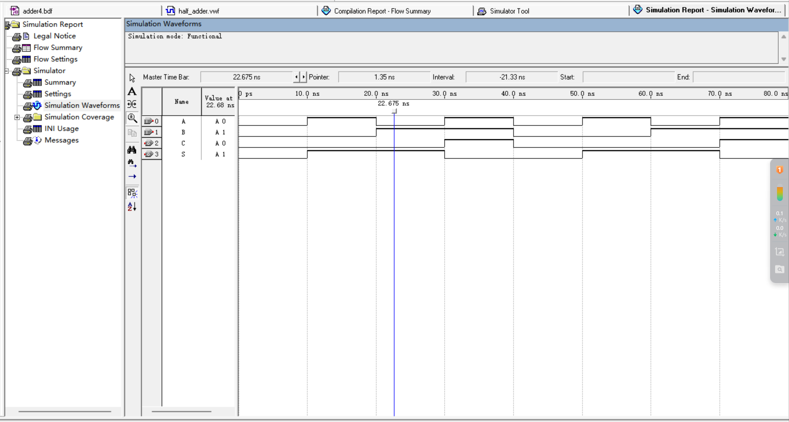

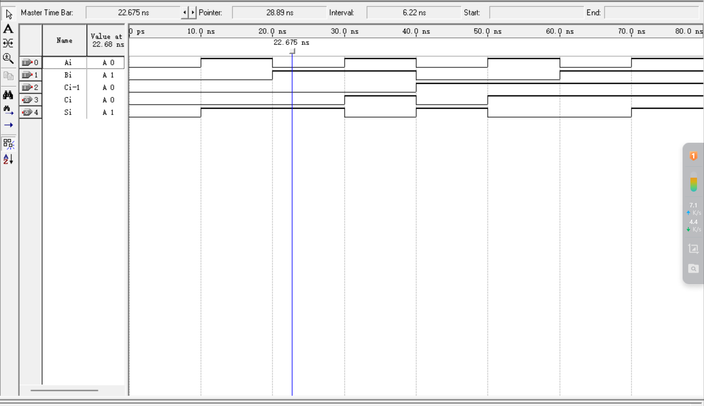

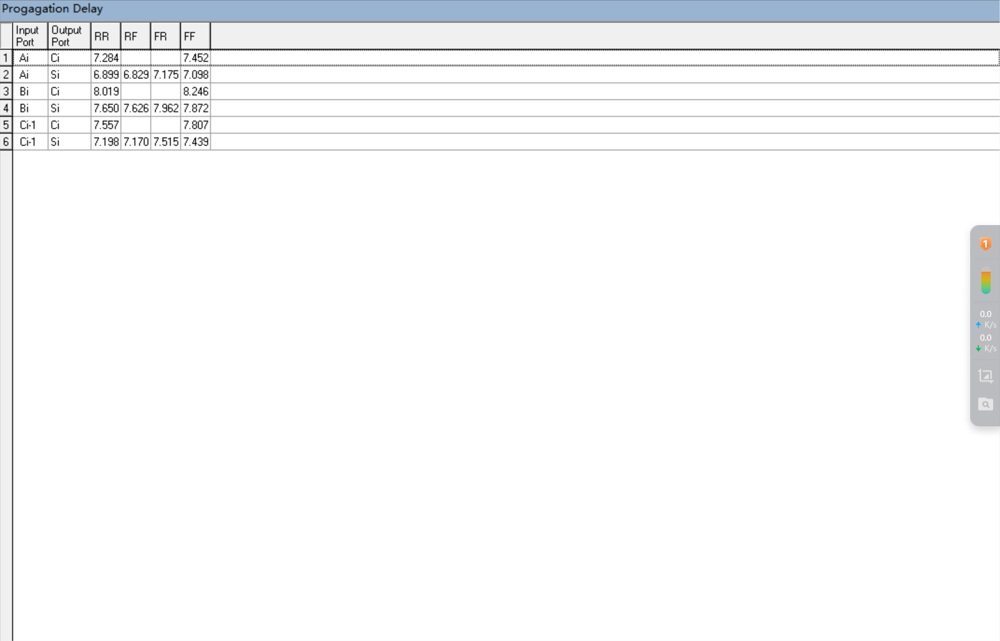

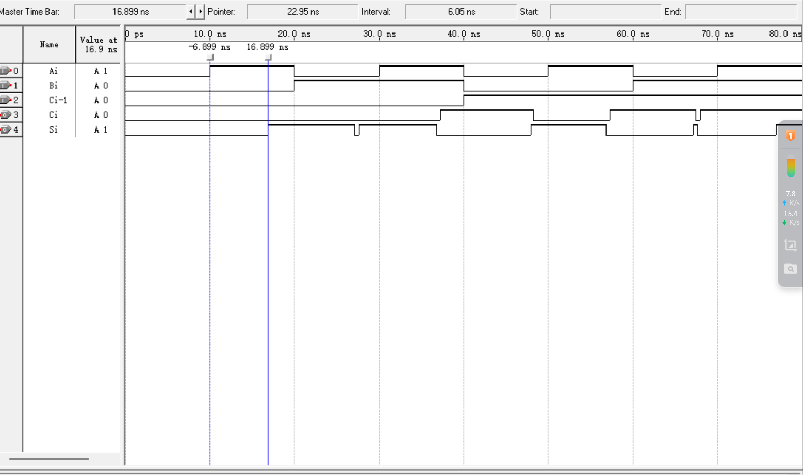

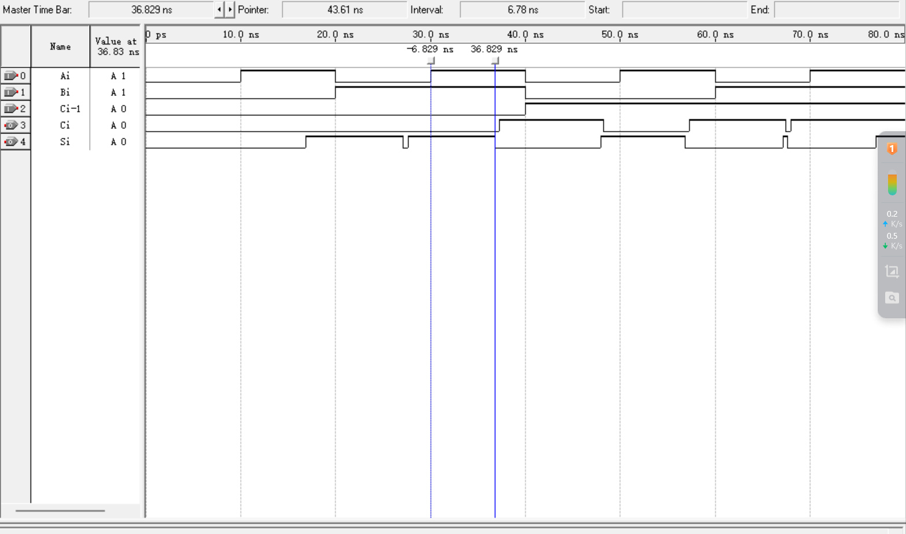

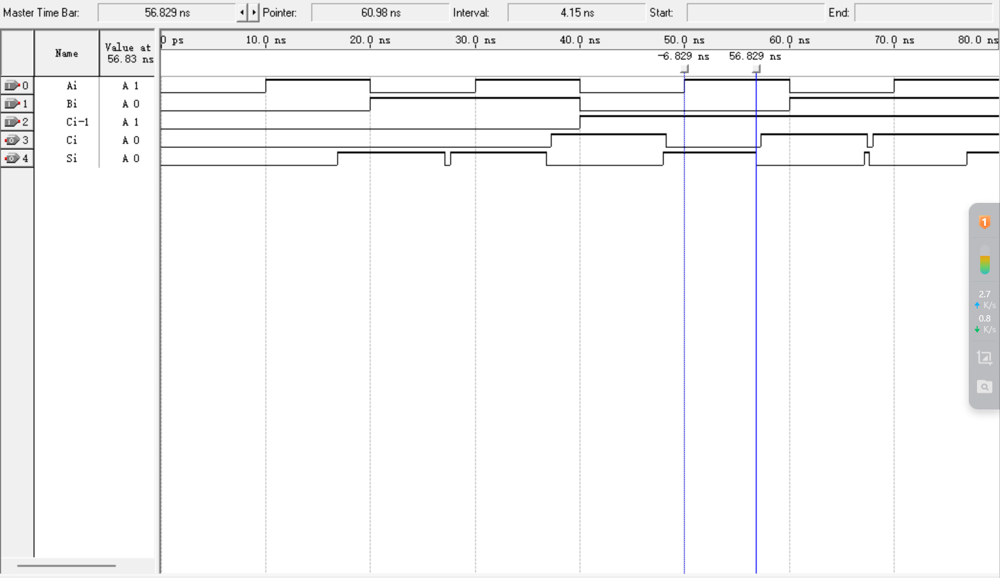

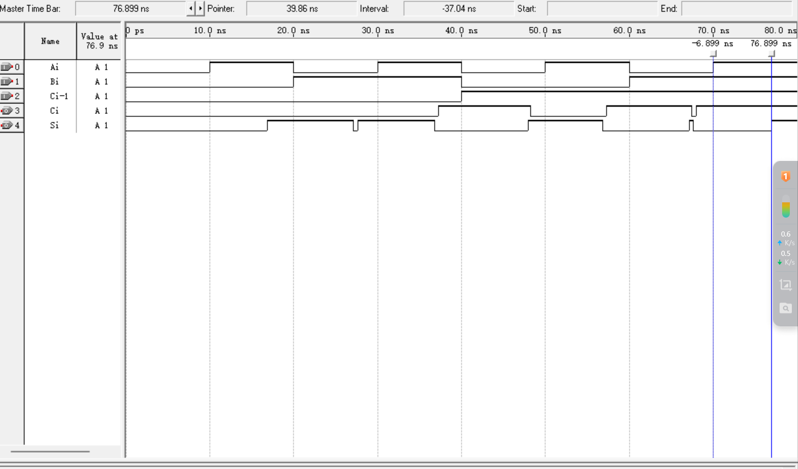

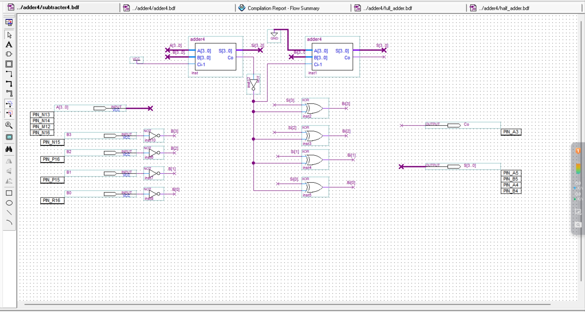

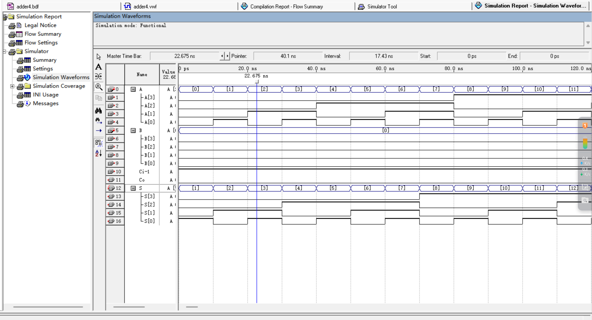

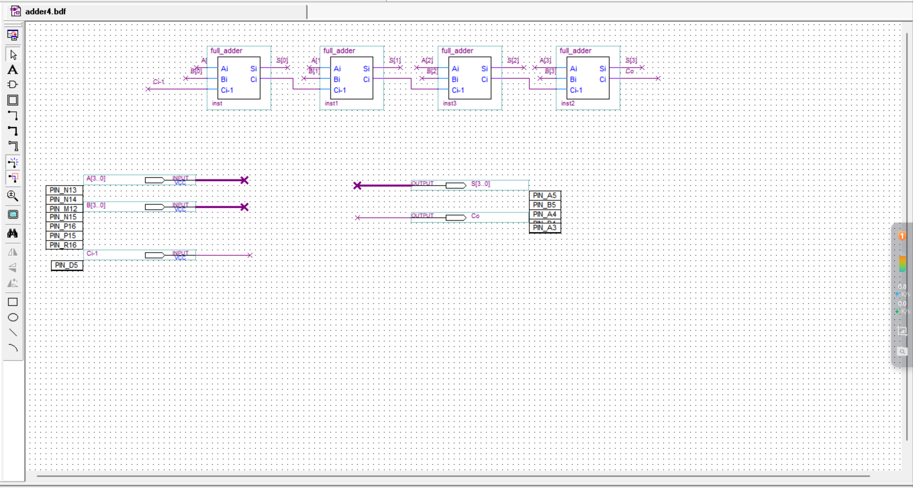

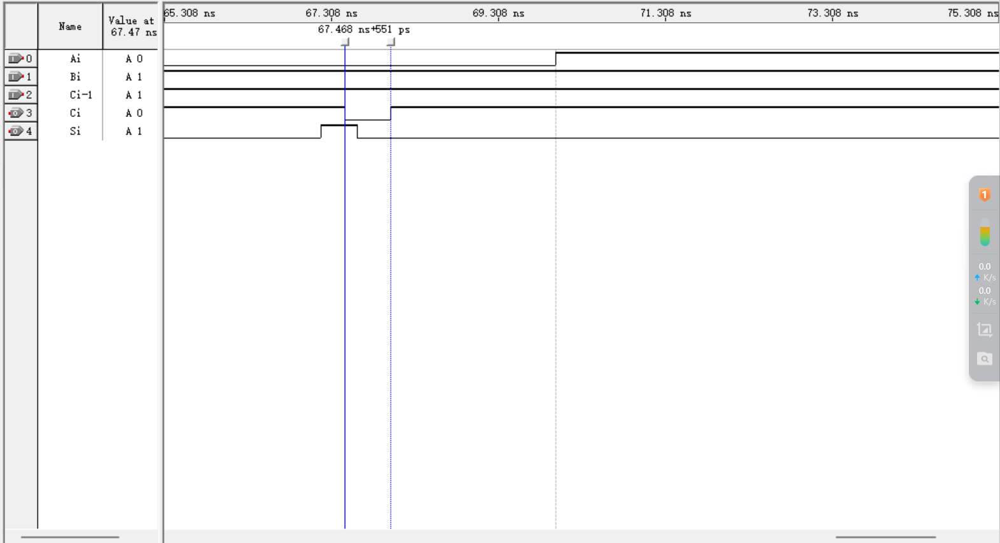

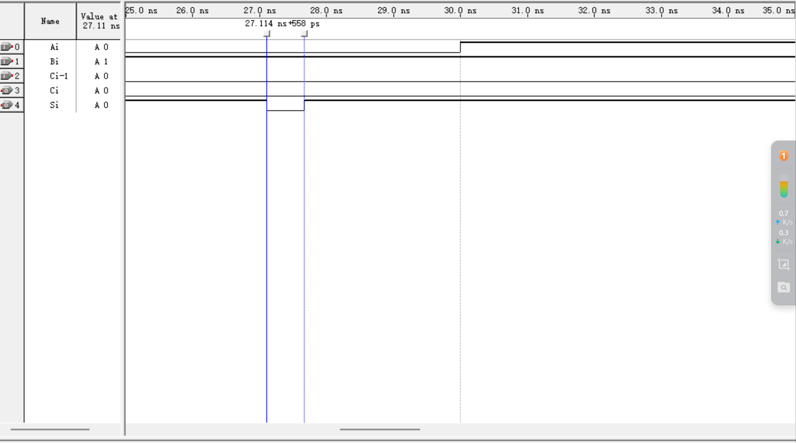

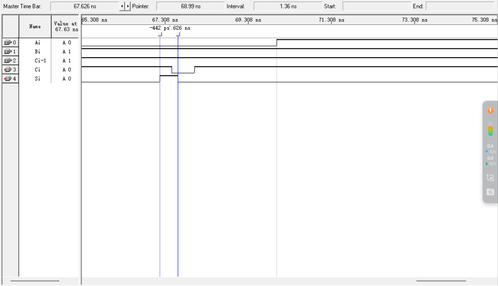

