# 东南大学电工电子实验中心

## 实 验 报 告

课程名称：电子工艺实践

实验名称：电子工艺实践

院（系）：电子科学与工程学院　专业：电子科学与技术

姓　　名：zhz　　学　　号：（已隐去）

实 验 室：电子技术实验2室103　实验组别：

同组人员：　　实验时间：2026年3月25日

---

东南大学电工电子实验中心

实 验 报 告

课程名称：     电子工艺实践

实验名称：          电子工艺实践

院 （系）：电子科学与工程学院专 业：电子科学与技术

姓    名：    zhz  	学    号：  （已隐去）

实 验 室: 电子技术实验2室103实验组别：

同组人员：              实验时间：2026年3月25日

评定成绩：              审阅教师：

## 一、实验目的：

识别和使用常用电子元器件，掌握常用电子仪器、仪表的使用方法；

熟悉电子产品的设计和生产过程；

掌握用Altium Designer软件设计原理图和印制电路板图；

掌握电路的焊接、安装、检查及调试方法；

## 二、实验原理：

流水灯电路工作原理分析；

本电路是一款基于通用数字逻辑芯片的4路单向广告流水灯电路，通过时钟产生、移位控制、逻辑复位、功能实现四个核心模块的协同工作，实现 LED 依次循环点亮的流水效果，       各模块原理如下：

时钟产生模块: 555定时器多谐振荡器，555定时器接成多谐振荡器模式，为整个电路提供稳定的方波时钟信号，控制流水灯的切换速度。电路参数：电源VCC=5.0V，电阻R5=1kΩ，R6=0-100kΩ，电容C2=10μF，C1=0.01μF。

工作原理：555 定时器通过电容C2的充放电实现振荡：

充电阶段：电源经R5、R6向C2充电，当C2电压升至 2/3VCC时，内部触发器翻转，输出端OUT变为低电平，同时内部放电管导通，C2开始放电。

放电阶段：C2经R6和内部放电管向地放电，当电压降至 1/3VCC时，触发器再次翻转，OUT变为高电平，放电管截止，C2重新充电。电路循环往复，在OUT端输出连续的方波脉冲，为移位寄存器提供时钟节拍。

频率计算：多谐振荡器周期公式：T≈0.7(R5+2R6max)C2=0.7×(1kΩ+2×100kΩ)×10μF=1.407s，对应振荡频率f≈1/T≈0.71Hz，T≈0.7(R5+2R6min)C2=0.7×(1kΩ)×10μF=7ms，对应振荡频率f≈1/T≈142.9Hz，即每秒约0.7到143个时钟脉冲，可通过控制滑阻的阻值来控制流水灯的切换速度。

移位控制模块：74HC194 4位双向移位寄存器，74HC194作用是将555的时钟脉冲转换为依次输出的高电平，控制LED的点亮顺序。初始状态：通电后 S0、S1为高，芯片执行并行置数，QA输出高电平，QB、QC、QD输出低电平，仅LED1点亮。移位过程：每来一个时钟上升沿，寄存器执行移位操作，高电平依次向后传递：

第1个脉冲：QA 的1移至QB，QA清零→LED2点亮，LED1熄灭。

第2个脉冲：QB 的1移至QC→LED3点亮，LED2熄灭。

第3个脉冲：QC 的1移至QD→LED4点亮，LED3熄灭。

循环复位：当QD的1移出后，4个输出端全为0，触发74HC20与非门输出低电平，使CLR有效，芯片清零并重新执行并行置数，回到QA=1的初始状态，实现无限循环。

功能实现模块：LED与限流电阻4个LED分别串联470Ω限流电阻，构成驱动电路，实现灯光显示。

工作原理：LED 为正向导通发光器件，当74HC194对应输出端为高电平时，LED 正向导通发光；输出为低电平时，无电流通过，LED 熄灭。

流水灯电路电路图如下图：

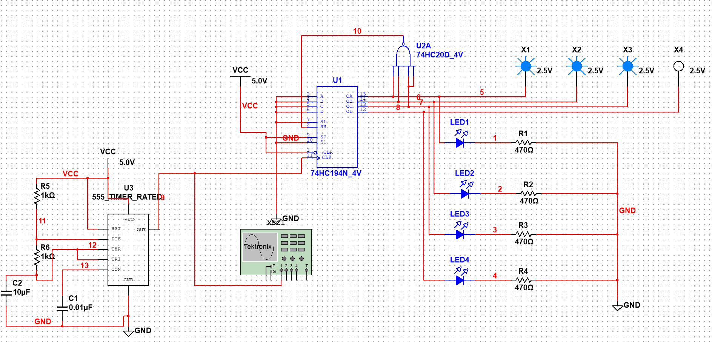

使用Altium Designer软件绘制原理图和PCB图的基本设计过程、注意事项；

原理图和PCB图的设计过程：

电路功能：4路广告流水灯，由555定时器、74HC194移位寄存器、74HC20与非门、LED、电阻、电容等元件组成。

设计目标：完成电路原理图绘制、元件封装设计/调用、PCB布局布线等。

设计规范：遵循嘉立创设计流程，满足规则、可制造性要求。

软件与资料准备

软件：嘉立创标准版，完成账号注册、软件安装与激活。

元件资料：

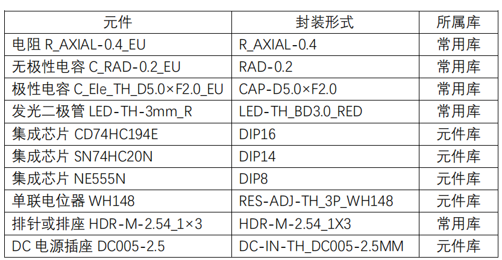

在嘉立创软件中根据电路原理图画出得到：

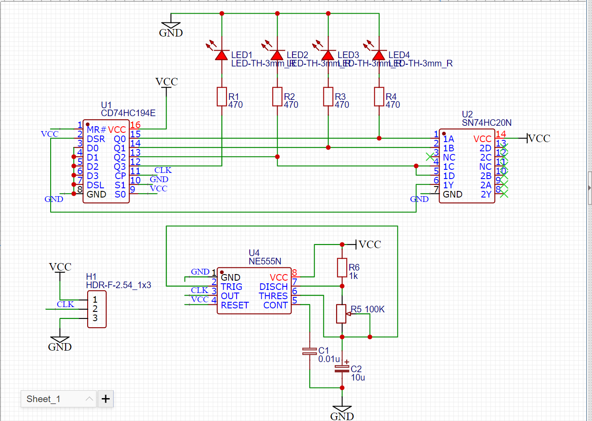

注意事项：

1. 元件封装选择：直插元件选择DIP封装，方便实验焊接；贴片元件适合批量生产，实验优先用直插。

2. 电源与地的处理：电源线加粗、铺铜接地，减少电源干扰，保证电路稳定工作。

3. 时钟线布线：555的时钟线尽量短，远离LED等负载线，避免信号干扰。

装配焊接工艺及注意事项。

焊接顺序的核心原则是：先低后高、先小后大、先非极性后极性。焊接方法遵循：将引脚插入焊盘，用烙铁加热焊盘与引脚，送焊锡，形成光亮的焊点，剪去多余引脚。

首先焊接贴片/小型直插阻容元件，先焊电阻（R1-R6）、无极性电容（C1）：这类元件无极性、高度低，优先焊接避免遮挡后续元件。然后焊接极性元件，焊接电解电容（C2）、LED（LED1-LED4）：注意要严格核对极性，电解电容长脚为正，对应PCB“+”标识；LED长脚为阳极，对应PCB阳极焊盘，避免反接烧毁。最后焊接芯片与接插件，焊接DIP芯片：使用芯片插座焊接，再插入芯片，避免直接焊接芯片导致高温损坏；焊接时先固定对角引脚，再依次焊接其余引脚，防止虚焊、连焊。最后焊接电源接口、测试点（X1-X4）、示波器接口等接插件，保证焊接牢固。

## 三、实验内容：

软件绘制的原理图及PCB图；

软件绘制的原理图：

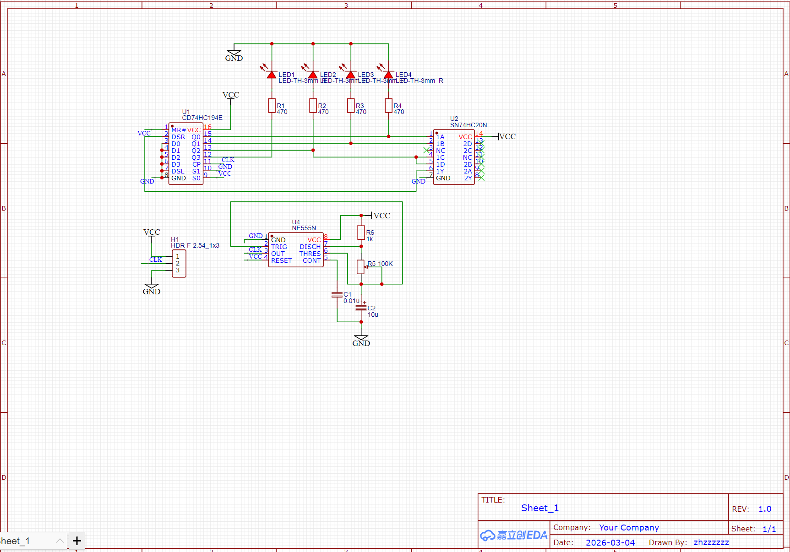

PCB图：

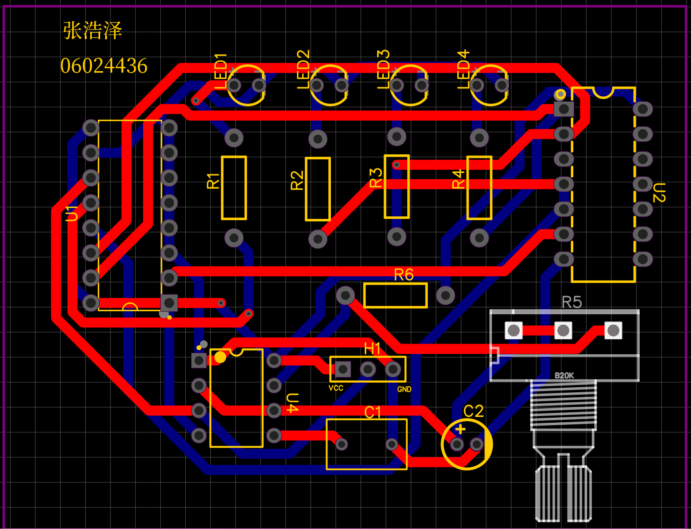

尺寸：2724.4mil×2090.8mil

万能板上制作的电路，正面、反面实物图；

正面实物图：

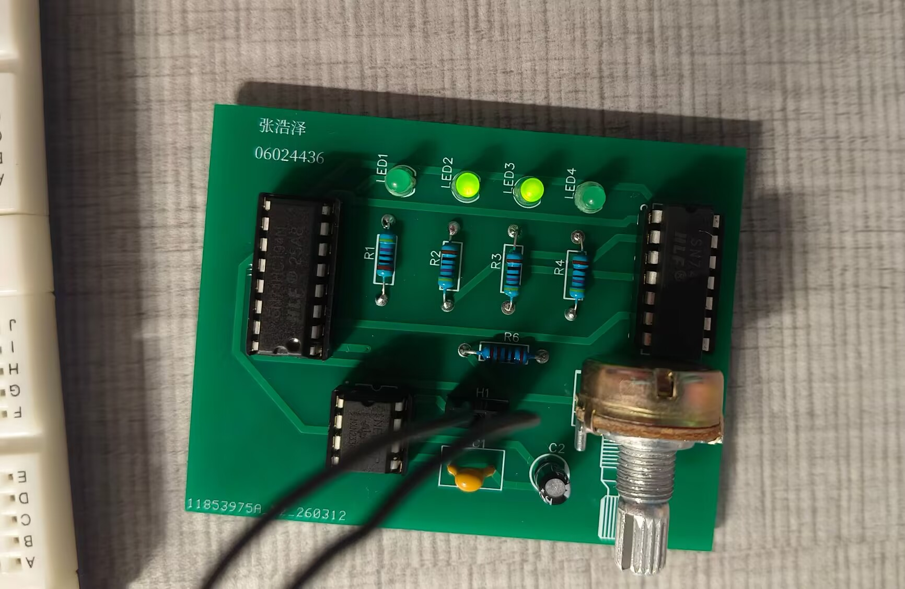

反面实物图：

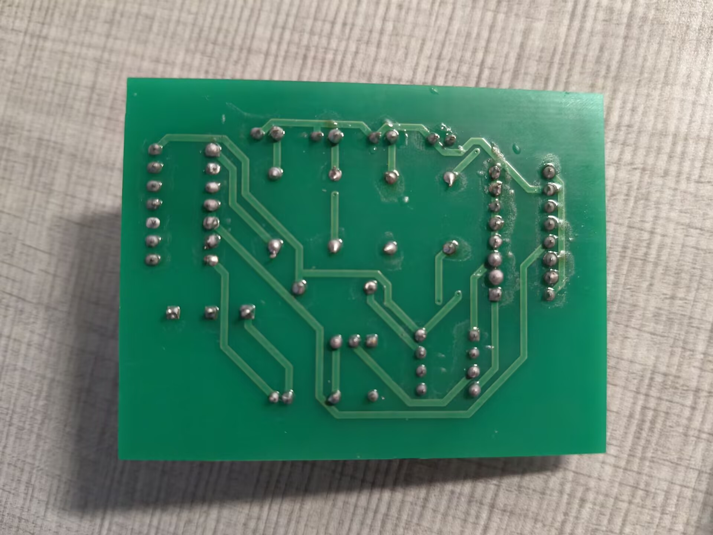

通电测试方法、结果，波形图及参数；遇到问题及解决过程及方法；

通电测试方法：首先将信号源波形调整至直流8V，将信号源两端口接入到电路板的VCC和GND接口处，同时将CLK信号通过导线引至示波器的CH1处，调整滑阻阻值，调整波形范围，观察示波器波形的变化，可以观察到电路生成的脉冲信号的频率在0.6Hz到143Hz范围内变化。示波器的波形实物图如下：

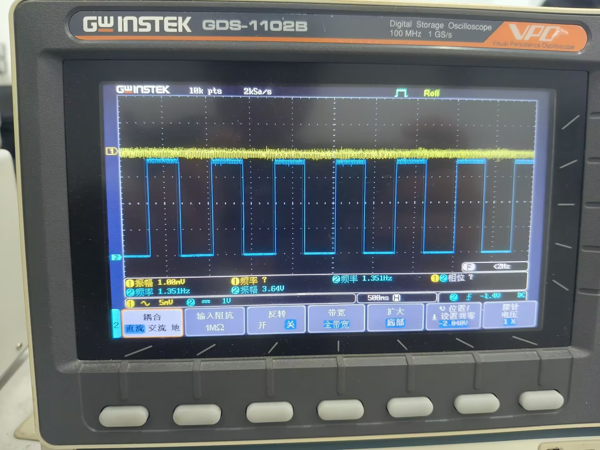

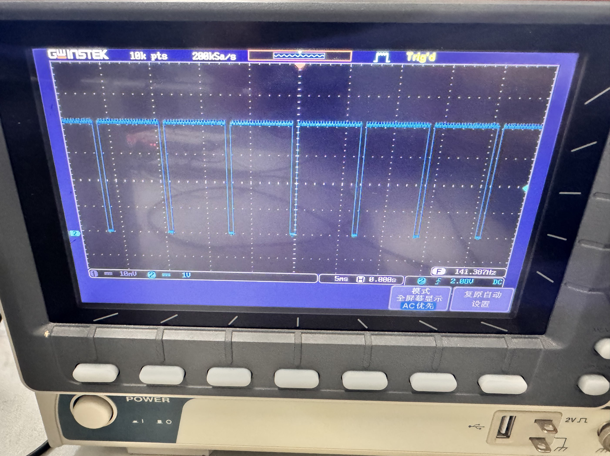

将示波器CH2接口分别接入到LED1-4，观察LED处波形变化，实物图片如下：

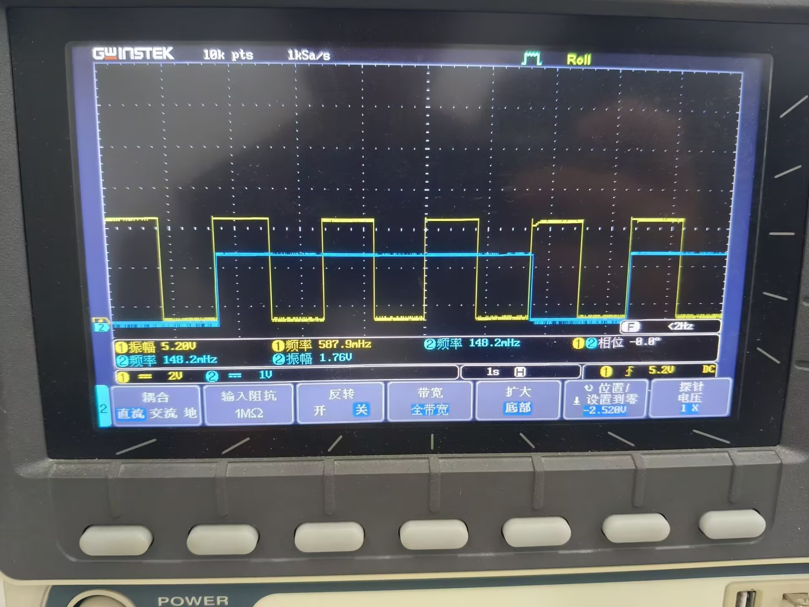

手绘CLK和LED1-4的波形图如下：

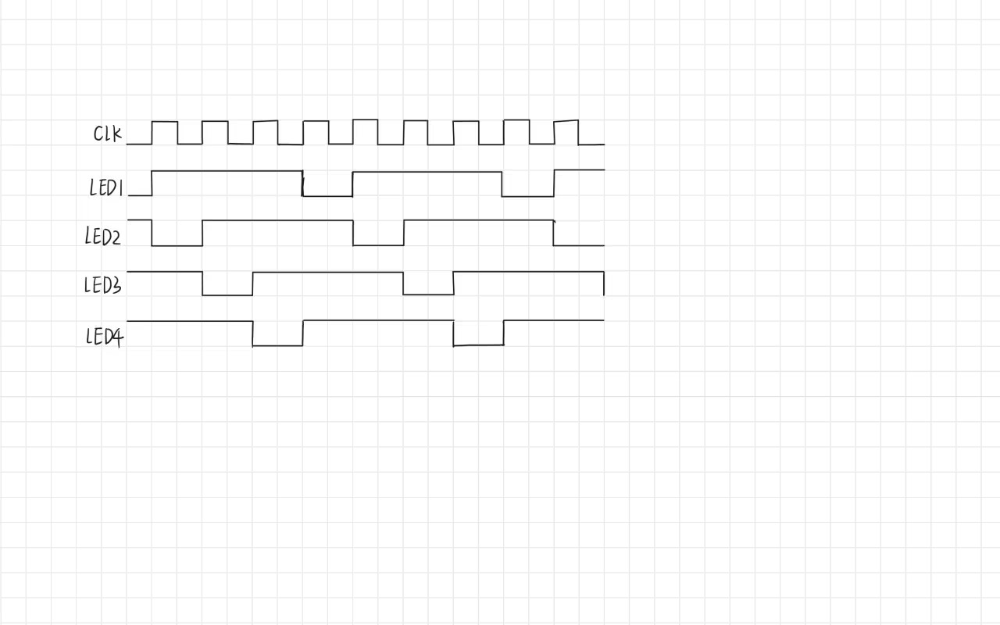

遇到问题及解决过程及方法：第一次设置信号源为直流5V的时候发现能正常观察到CLK的频率，但是无法观察到LED灯的闪烁变化。此现象说明脉冲产生电路555部分没有出现错误，仔细检查原理图发现原理图也没有任何错误，根据示波器CH2接口波形推断可能是电路板上74HC194部分出现虚焊等错误。这时候依次测量74HC194四个输出口和左移变量的波形和电压，发现电压在2.5V左右，这时候推断芯片引脚并没有达到阈值电压无法实现相应的功能。故将电压依次提升到5.5V、6V直至7V-8V，这时候LED灯出现明显的闪烁变化。除此之外我发现LED1灯会依据逻辑进行亮度变化，但是亮度较其他三个灯明显更低，排除194逻辑问题，可能限流电阻1出现虚焊。总结：本次调试的两类故障，核心诱因均为电路板焊接过程中的虚焊问题：74HC194引脚虚焊导致输出电压不足，无法驱动 LED；R1虚焊导致回路电流不足，LED1亮度偏低。调试过程中使用的方法：数字电路调试遵循“先模块定位、再参数检测、后验证修复”的原则。

通过Multisim软件仿真流水灯电路，观察仿真波形。（提高）

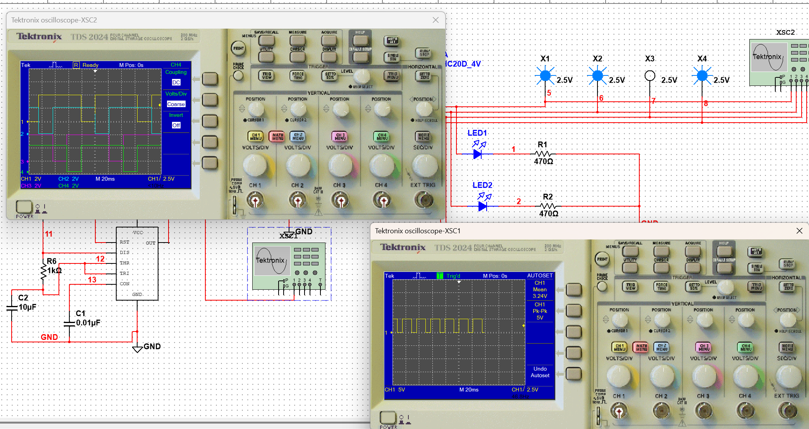

将滑阻阻值设置为1kΩ，对电路进行仿真，仿真波形如图所示。

## 四、心得体会及建议：

通过本次电子工艺实践，我经历了广告流水灯电路从原理分析、原理图与 PCB 设计、装配焊接到通电调试、仿真验证的全过程，基本掌握了电子工艺的基本流程与核心技能。

在理论方面，我深入理解555定时器多谐振荡、74HC194移位寄存器、74HC20与非门复位的工作原理，掌握了时钟产生、移位控制、循环驱动等数字电路模块的协同工作机制，能够根据公式计算振荡频率，并通过电位器实现流水速度调节，对数字电路的时序逻辑有了更直观的认识。

在软件应用方面，我熟练使用嘉立创EDA完成了原理图绘制、元件库调用、封装匹配、PCB布局布线及DRC检查，理解了PCB设计中模块分区、电源加粗、地线铺铜、时钟线短捷等设计原则，提升了工程绘图与规范设计能力。

在实操工艺方面，我按照合理的顺序完成焊接，掌握了直插元件、芯片、LED、电容的焊接技巧与焊点质量判断标准，认识到虚焊、极性接反、接触不良是实验电路最常见问题。

在调试与故障处理方面，我学会使用示波器、万用表观测波形与电压，按照先模块定位、再参数检测、后验证修复的思路排查故障，成功解决5V供电下LED不闪烁、单路LED亮度偏低等问题，提升了电路分析与问题解决能力。同时通过Multisim仿真对比验证，加深了理论与实际的结合。

本次实验让我切实体会到严谨的设计、规范的焊接、耐心的调试是电子产品成功的关键。未来我会更加注重工艺规范与电路可靠性设计，不断提升动手能力与工程素养，为后续专业学习打下扎实基础。
