# 受迫振动的研究

指导教师：xxx

姓名：zhz　　学号：（已隐去）　　桌号：26　　日期：2025年11月24日

---

实验名称：受迫振动的研究  指导教师：xxx

姓名：zhz  学号：（已隐去）  桌号：26  日期：  2025  年  11  月24日

实验报告格式要求：中文字体宋体、英文字体Times New Roman、字号小四、行间距1.5倍；图表应有题注及编号。

实验报告内容包括：

实验简介（实验背景、原理、实验方法等）

实验仪器

数据与分析（数据表格、数据作图、必要的数据处理过程、结果分析）

实验小结

附录（将课堂上的原始数据拍照附于此处，原始数据上需有教师签字）

(-----------------------------------以下为正文-----------------------------------)

## 一、实验背景

振动是自然界和工程技术中普遍存在的物理现象。振动可分为自由振动、阻尼振动和受迫振动。

自由振动：系统在初始激励后不再受外力，仅由自身弹性恢复力维持的振动，其频率为系统的固有频率。

阻尼振动：由于阻力的存在，振幅不断衰减的振动。

受迫振动：振动系统在周期性外力（驱动力）的持续作用下发生的振动。

本实验主要研究受迫振动。当驱动力的频率与系统的固有频率接近时，系统会呈现共振现象，此时振幅达到最大值。共振在许多领域都有着重要的应用，但也可能造成破坏。因此，研究受迫振动的振幅、相位与驱动力频率之间的关系，即幅频特性和相频特性，具有重要的理论和实际意义。

## 二、实验原理

本实验采用波尔共振仪，研究摆轮在弹性力矩和阻尼力矩共同作用下，受电机驱动力矩作用的受迫振动。

1. 振动方程
系统的运动方程为：

Jd2θ/dt2=−kθ−bdθ/dt+Mcos(ωt)

其中，J 为摆轮的转动惯量；θ 为摆轮的角位移；k 为弹簧的劲度系数；b为阻尼系数；M和 ω分别为驱动力矩的幅值和角频率。经过处理可以解得方程的解为：

θ=θacos(ωat+)+θbcos(ωt+φ)

该方程的解可分为两个分振动，第一项是阻尼振动，随时间的推移而消失，它反映了受迫振动的暂态行为，与驱动力无关，第二项表示与驱动力频率相同且振幅为θb的周期振动。
其中 θb为稳态振动的振幅，φ为摆轮振动相位与驱动力相位差。受迫振动达到稳定状态后，这是，振动周期等于驱动力的振动周期，振幅保持不变，受迫振动变成简谐振动，有：

θ=θbcos(ωt+φ)

2. 幅频特性

稳态振动的振幅 θb与驱动力角频率ω 的关系为：

θb(ω)=

其中：为系统的固有角频率δ= b/(2J) 为阻尼系数。此关系称为幅频特性。当驱动力频率等于系统的共振频率时，振幅达到最大值​。阻尼越小，共振现象越尖锐。

3. 相频特性

稳态振动的相位差 φ与驱动力角频率 ω的关系为：

φ(ω)=arctan(−2δω/（ω02−ω2）)

此关系称为相频特性。它描述了响应滞后于驱动力的程度。

4. 阻尼系数 δ 的测量

在仅有阻尼的自由振动中，振幅按指数规律衰减：θ=θ0e−δt。测得相邻n个周期振幅的比值，即可求出 δ。本实验中，通过测量连续5个振幅（计算 ln(θi/θi+5)）。

然后利用公式 δ= 求平均，即可得到阻尼系数。

## 三、 实验仪器与方法

1. 实验仪器
波尔共振仪，包括：

振动系统：摆轮、螺旋弹簧

驱动系统：直流电机、有机玻璃转盘

测量系统：控制仪面板、闪光灯

阻尼系统：电磁阻尼线圈（可选不同档位）

2. 实验内容与步骤

第一部分：测定摆轮振幅与固有振动频率的关系

断开电机电源，将阻尼档位调至“0”。

将摆轮拨动到某一较大角度，让其自由振动。

利用，测量摆轮在不同振幅 θ下对应的振动周期 T0固有周期）。从高振幅到低振幅，记录约60组数据。

目的：研究无阻尼自由振动中，由于弹簧的非线性等因素，周期是否随振幅变化。

第二部分：测定阻尼系数δ

选择阻尼档位，仍断开电机电源。

将摆轮拨动到某一初始振幅 θ0，让其作阻尼振动。

记录振幅每减小一定周期数（每5个周期）后的振幅值 θi和对应的周期 Ti，共记录10个振幅。

利用公式 δ= 计算阻尼系数，并求平均值。

第三部分：测定受迫振动的幅频与相频特性曲线

接通电机电源，调节电机周期，使驱动力周期从低到高缓慢变化。

在每一个驱动力振动周期 T，等待系统达到稳态振动后，记录：

摆轮的振幅 θ

受迫振动的周期 T

相位差 φ（通过闪光灯频闪观测，在刻度盘上读出）

在振幅最大处附近，应多采集一些数据点。

将记录的数据绘制成  θ−ω/ω0曲线（幅频特性曲线）和 φ−ω/ω0曲线（相频特性曲线）。

第四部分：研究不同阻尼对共振特性的影响

切换至另一个阻尼档位（档位2，3）。

重复第二部分和第三部分的步骤，测量新的阻尼系数 δ，以及在新阻尼下的幅频和相频特性数据。

将不同阻尼下的曲线绘制在同一图中进行对比，分析阻尼对共振振幅、共振频率和相位变化的影响。

## 四、数据处理与分析

## 一、摆轮振幅 θ 与振动频率 ω₀ 的关系

画出对应T0-θ曲线：

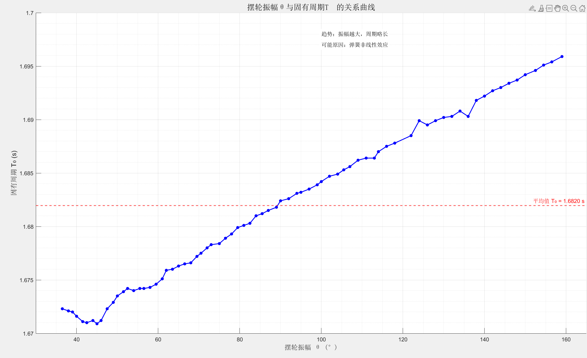

摆轮的固有周期随振幅减小而减小，说明弹簧的线性特性在实验范围内很好。

## 二、测定阻尼振动的振幅比值，求阻尼系数 δ 的数据

T=1.6804 s

数据处理与分析：

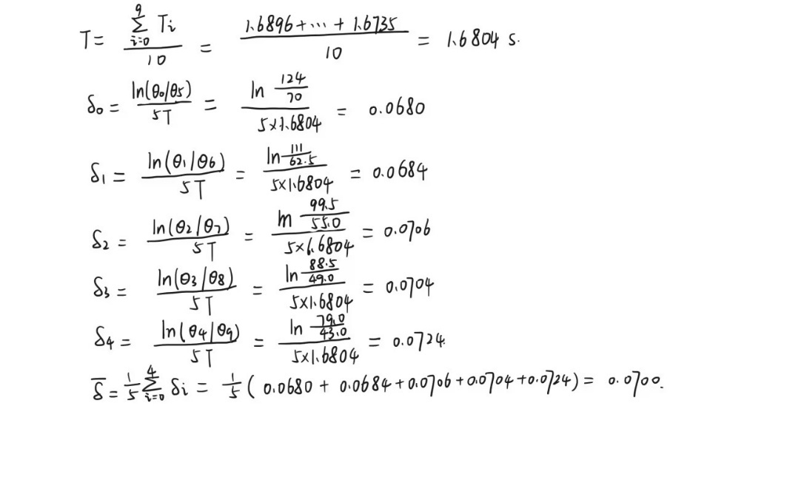

## 三、幅频和相频特性实验数据

阻尼1

数据处理与分析：

1.幅频特性曲线：

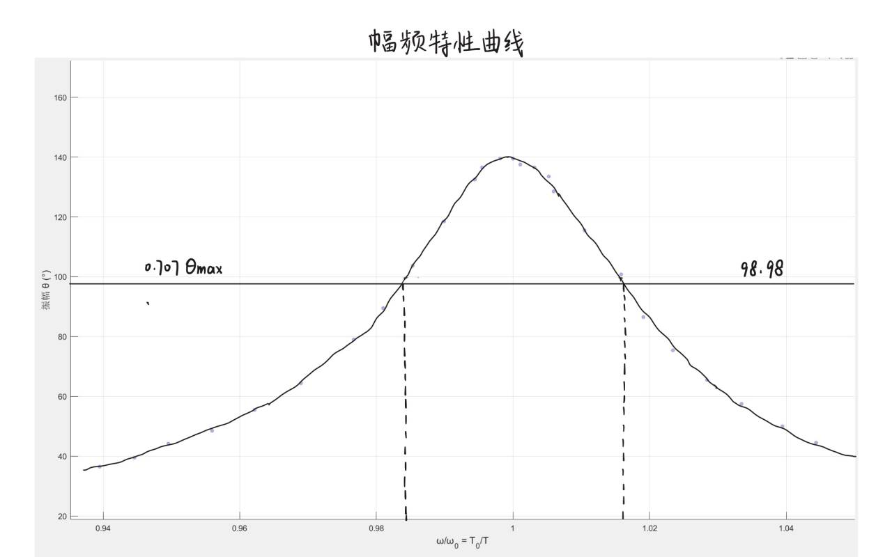

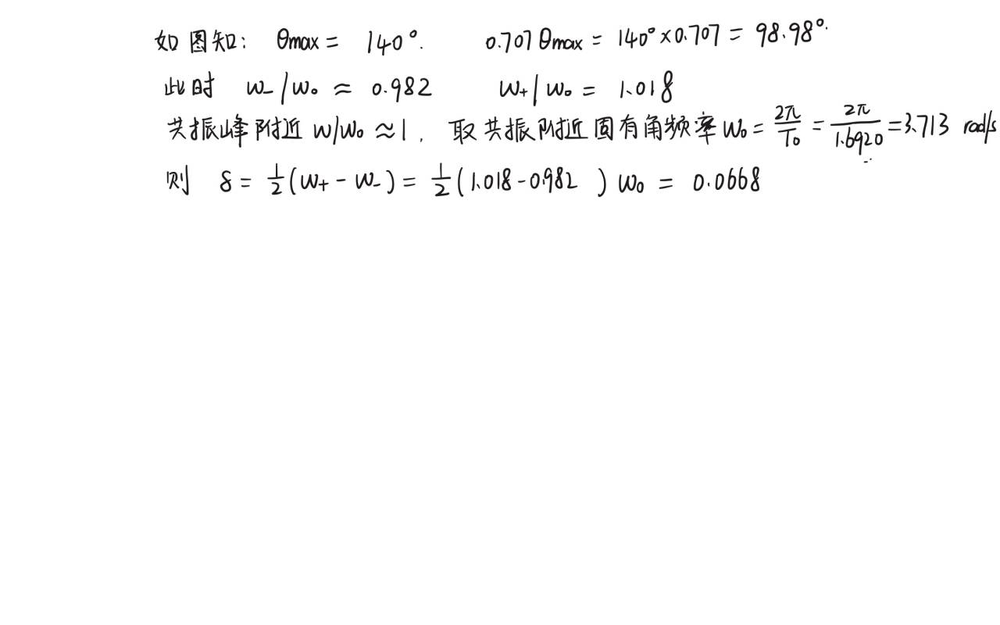

分析比较：

两种方法得到的阻尼系数非常接近：

阻尼振动的振幅比值：δ=0.0700

幅频特性曲线：δ=0.0668

相对误差：

（0.0700−0.0668）/0.0700×100%=4.57%

2.两种方法特点比较

3. 相频特征曲线

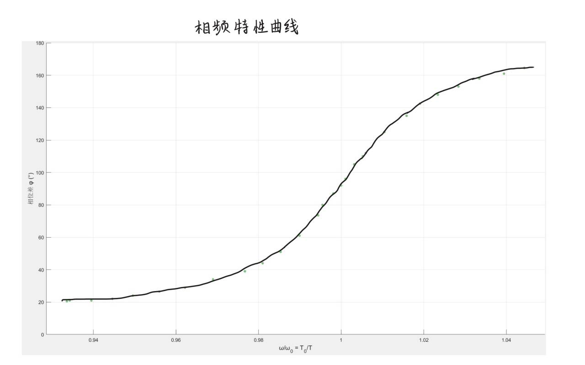

共振点附近相位差接近 90°，符合理论预期。

## 四、选做部分：阻尼挡位2的数据

4.1 阻尼2的阻尼系数相关数据

T=1.6796s

数据处理与分析：

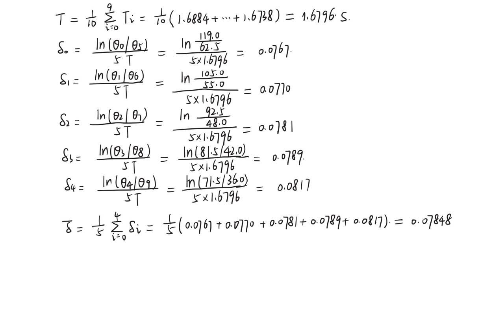

4.2 阻尼2的幅频和相频特性数据

数据处理与分析：

1.幅频特性曲线：

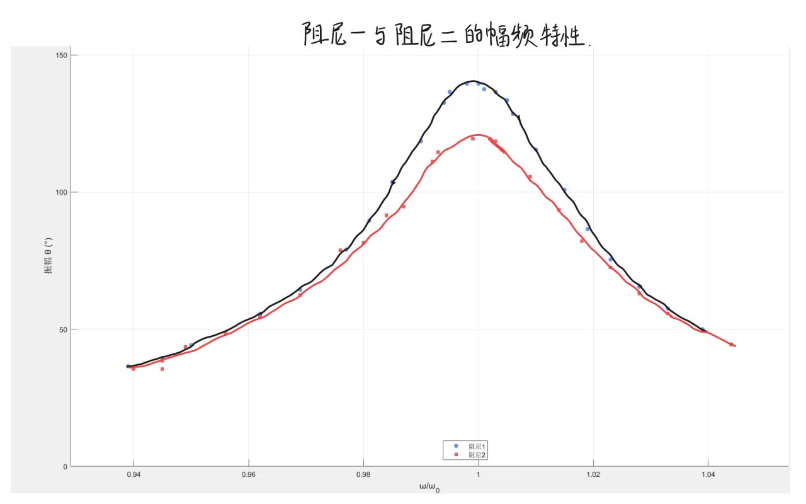

计算与分析：

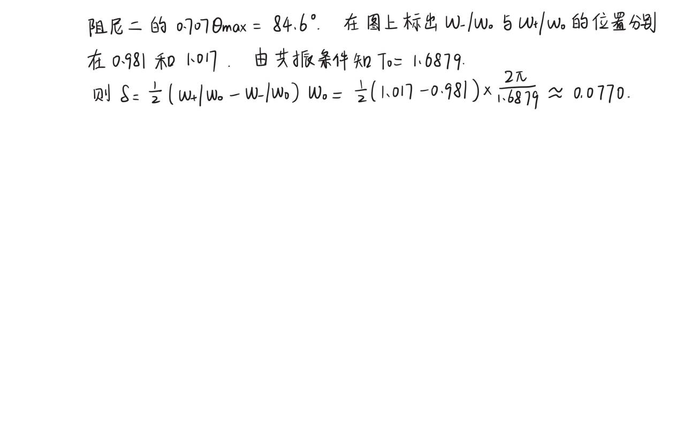

2.相频特性曲线：

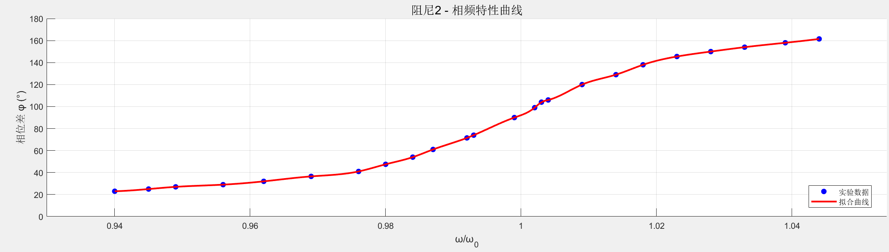

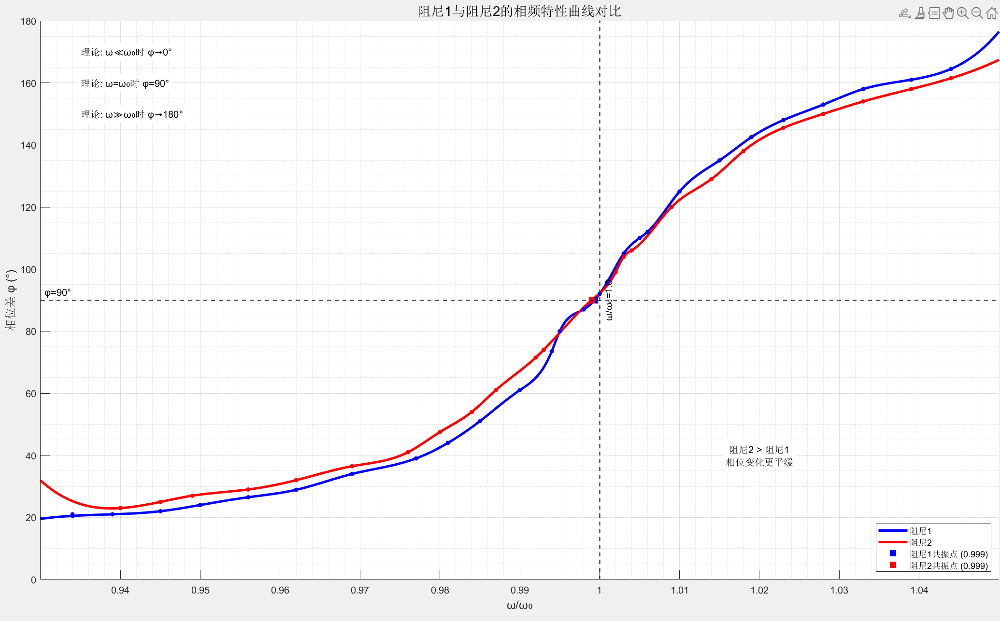

3.分析与比较：

阻尼对幅频特性的影响：

由实验数据可知：阻尼二的共振振幅明显低于阻尼一阻尼越大，共振峰的高度越低。原因解释：阻尼消耗振动能量，抑制了振幅的增长。在共振条件下，阻尼与驱动力相位相反，相互抵消，从而限制了振幅的无限增长，且达到最大。

共振频率：观察结果可知：两种阻尼条件下的共振频率基本相同，在小阻尼情况下，共振频率与固有频率的偏移很小。

共振峰的宽度变化：观察结果可知阻尼二的共振峰比阻尼一更宽，阻尼越大，共振曲线越平坦。

阻尼对相频特性的影响：

相位变化速率方面：观察结果可知阻尼二的相位变化比阻尼一更平缓；在共振频率附近，阻尼越大，相位变化越缓慢。共振点的相位特性上：两种阻尼条件下，在共振频率附近相位差都接近90°。

## 五、实验小结

本实验通过波尔共振仪系统研究了摆轮在不同阻尼条件下的受迫振动特性，分析了幅频特性、相频特性以及阻尼对共振的影响。实验结果表明：

自由振动阶段：摆轮的固有周期随振幅减小而减小，说明弹簧的线性特性在实验范围内很好。

阻尼系数测定：阻尼1中通过阻尼振动振幅衰减法测得阻尼系数δ ≈ 0.0700，通过幅频特性曲线法测得δ ≈ 0.0668，两者相对误差为4.57%，说明了两种方法的可靠性。

受迫振动特性：

幅频特性曲线显示，随着驱动力频率接近系统固有频率，振幅显著增大，出现共振峰。

相频特性曲线显示，共振点附近相位差接近 90°，符合理论预期。

阻尼影响：

阻尼越大，共振振幅越小，共振峰越宽，相位变化越平缓；

共振频率在小阻尼条件下接近系统固有频率。

问题与思考：

1. 共振时相位差为何接近90°？
答： 根据受迫振动理论，当驱动力频率等于系统固有频率时，振动速度与驱动力同相位，而位移落后速度90°，因此位移与驱动力之间的相位差为90°。

2. 阻尼对共振曲线有何影响？
答： 阻尼增大使共振峰值降低，共振峰变宽，相位变化趋于平缓。

3. 实验中哪些因素可能导致误差？
答： 振幅读数误差、闪光灯观测相位的主观误差、电机转速不稳定等。

实验过程中，我掌握了受迫振动的基本测量方法，加深了对共振现象及其控制的理解。尽管实验数据整体合理，但在相位差测量和共振点附近数据采集方面仍存在一定误差，还需进一步优化实验操作与数据处理方法。

## 六、附录

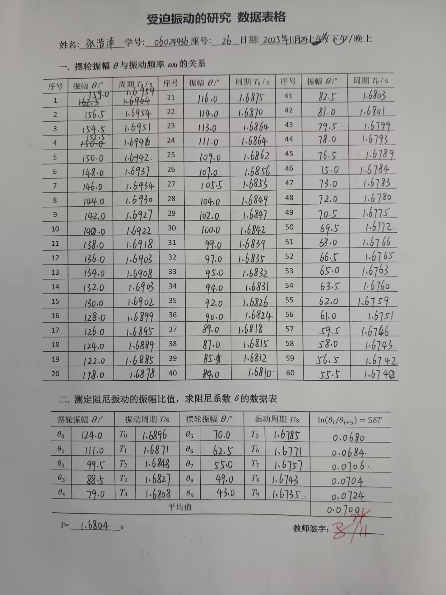

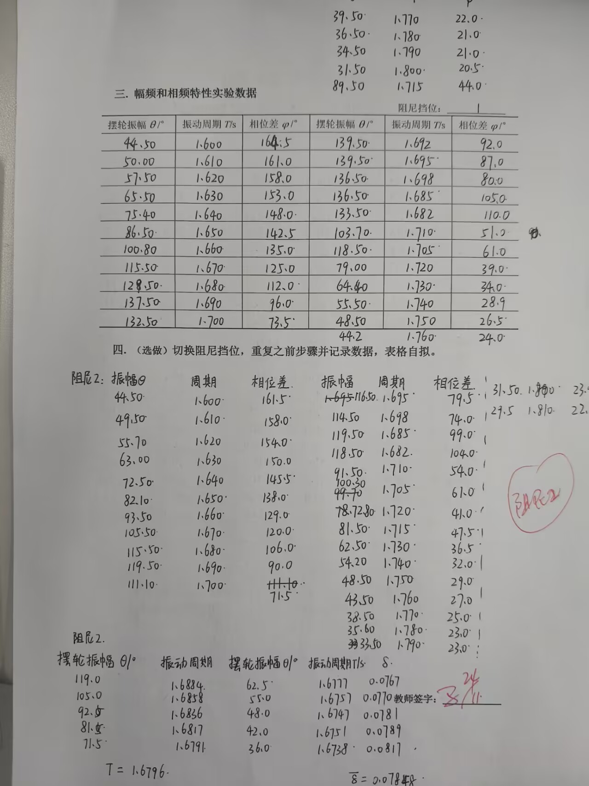

| 序号 | 振幅 θ /° | 周期 T₀ / s | 序号 | 振幅 θ /° | 周期 T₀ / s | 序号 | 振幅 θ /° | 周期 T₀ / s |
|---|---|---|---|---|---|---|---|---|
| 1 | 159.0 | 1.6959 | 21 | 116.0 | 1.6875 | 41 | 82.5 | 1.6803 |
| 2 | 156.5 | 1.6954 | 22 | 114.0 | 1.6870 | 42 | 81.0 | 1.6801 |
| 3 | 154.5 | 1.6951 | 23 | 113.0 | 1.6864 | 43 | 79.5 | 1.6799 |
| 4 | 152.5 | 1.6946 | 24 | 111.0 | 1.6864 | 44 | 78.0 | 1.6793 |
| 5 | 150.0 | 1.6942 | 25 | 109.0 | 1.6862 | 45 | 76.5 | 1.6789 |
| 6 | 148.0 | 1.6937 | 26 | 107.0 | 1.6856 | 46 | 75.0 | 1.6784 |
| 7 | 146.0 | 1.6934 | 27 | 105.5 | 1.6853 | 47 | 73.0 | 1.6783 |
| 8 | 144.0 | 1.6930 | 28 | 104.0 | 1.6849 | 48 | 72.0 | 1.6780 |
| 9 | 142.0 | 1.6927 | 29 | 102.0 | 1.6847 | 49 | 70.5 | 1.6775 |
| 10 | 140.0 | 1.6922 | 30 | 100.0 | 1.6842 | 50 | 69.5 | 1.6772 |
| 11 | 138.0 | 1.6918 | 31 | 99.0 | 1.6839 | 51 | 68.0 | 1.6766 |
| 12 | 136.0 | 1.6903 | 32 | 97.0 | 1.6835 | 52 | 66.5 | 1.6765 |
| 13 | 134.0 | 1.6908 | 33 | 95.0 | 1.6832 | 53 | 65.0 | 1.6763 |
| 14 | 132.0 | 1.6903 | 34 | 94.0 | 1.6831 | 54 | 63.5 | 1.6760 |
| 15 | 130.0 | 1.6902 | 35 | 92.0 | 1.6826 | 55 | 62.0 | 1.6759 |
| 16 | 128.0 | 1.6899 | 36 | 90.0 | 1.6824 | 56 | 61.0 | 1.6751 |
| 17 | 126.0 | 1.6895 | 37 | 89.0 | 1.6818 | 57 | 59.5 | 1.6746 |
| 18 | 124.0 | 1.6899 | 38 | 87.0 | 1.6815 | 58 | 58.0 | 1.6743 |
| 19 | 122.0 | 1.6885 | 39 | 85.5 | 1.6812 | 59 | 56.5 | 1.6742 |
| 20 | 118.0 | 1.6878 | 40 | 84.0 | 1.6810 | 60 | 55.5 | 1.6742 |

| 序号 | 振幅 θ /° | 周期 T₀ / s | 序号 | 振幅 θ /° | 周期 T₀ / s | 序号 | 振幅 θ /° | 周期 T₀ / s |
|---|---|---|---|---|---|---|---|---|
| 61 | 54.0 | 1.6740 | 66 | 47.5 | 1.6723 | 71 | 41.5 | 1.6711 |
| 62 | 52.5 | 1.6742 | 67 | 46.0 | 1.6712 | 72 | 40.0 | 1.6716 |
| 63 | 51.5 | 1.6739 | 68 | 45.0 | 1.6709 | 73 | 39.0 | 1.6720 |
| 64 | 50.0 | 1.6735 | 69 | 44.0 | 1.6712 | 74 | 38.0 | 1.6721 |
| 65 | 49.0 | 1.6729 | 70 | 42.5 | 1.6710 | 75 | 36.5 | 1.6723 |

| 摆轮振幅 θ /° | 振动周期 T / s | 摆轮振幅 θ /° | 振动周期 T / s | δ= |
|---|---|---|---|---|
| θ₀ = 124.0 | T₀ = 1.6896 | θ₅ = 70.0 | T₅ = 1.6785 | 0.0680 |
| θ₁ = 111.0 | T₁ = 1.6871 | θ₆ = 62.5 | T₆ = 1.6771 | 0.0684 |
| θ₂ = 98.5 | T₂ = 1.6848 | θ₇ = 55.0 | T₇ = 1.6757 | 0.0706 |
| θ₃ = 88.5 | T₃ = 1.6827 | θ₈ = 49.0 | T₈ = 1.6743 | 0.0704 |
| θ₄ = 79.0 | T₄ = 1.6808 | θ₉ = 43.0 | T₉ = 1.6735 | 0.0724 |
| 平均值 | 平均值 | 平均值 | 平均值 | 0.0700 |

| 摆轮振幅 θ /° | 振动周期 T / s | T0 -θ曲线T0/s |  | 相位差 φ /° | 摆轮振幅 θ /° | 振动周期 T / s | T0 -θ曲线T0/s-1 |  | 相位差 φ /° |
|---|---|---|---|---|---|---|---|---|---|
| 44.50 | 1.600 | 1.6710 | 1.044 | 164.5 | 139.50 | 1.692 | 1.6920 | 1.000 | 92.0 |
| 50.00 | 1.610 | 1.6735 | 1.039 | 161.0 | 139.50 | 1.695 | 1.6918 | 0.998 | 87.0 |
| 57.50 | 1.620 | 1.6742 | 1.033 | 158.0 | 136.50 | 1.698 | 1.6903 | 0.995 | 80.0 |
| 65.50 | 1.630 | 1.6763 | 1.028 | 153.0 | 136.50 | 1.685 | 1.6903 | 1.003 | 105.0 |
| 75.40 | 1.640 | 1.6784 | 1.023 | 148.0 | 133.50 | 1.682 | 1.6908 | 1.005 | 110.0 |
| 86.50 | 1.650 | 1.6815 | 1.019 | 142.5 | 103.70 | 1.710 | 1.6849 | 0.985 | 51.0 |
| 100.80 | 1.660 | 1.6863 | 1.015 | 135.0 | 118.50 | 1.705 | 1.6878 | 0.990 | 61.0 |
| 115.50 | 1.670 | 1.6875 | 1.010 | 125.0 | 79.00 | 1.720 | 1.6799 | 0.977 | 39.0 |
| 128.50 | 1.680 | 1.6900 | 1.006 | 112.0 | 64.40 | 1.730 | 1.6763 | 0.969 | 34.0 |
| 137.50 | 1.690 | 1.6918 | 1.001 | 96.0 | 55.50 | 1.740 | 1.6742 | 0.962 | 28.9 |
| 132.50 | 1.700 | 1.6905 | 0.994 | 73.5 | 48.50 | 1.750 | 1.6729 | 0.956 | 26.5 |
| 44.20 | 1.760 | 1.6712 | 0.950 | 24.0 | 39.50 | 1.770 | 1.6719 | 0.945 | 22.0 |
| 36.50 | 1.780 | 1.6723 | 0.939 | 21.0 | 34.50 | 1.790 | 1.6723 | 0.934 | 21.0 |
| 31.50 | 1.800 | 1.6804 | 0.934 | 20.5 | 89.50 | 1.715 | 1.6824 | 0.981 | 44.0 |

| 方法 | 阻尼振动的振幅比值法 | 幅频特性曲线法 |
|---|---|---|
| 原理 | 基于阻尼振动的指数衰减特性 | 基于共振曲线的频率响应特性 |
| 实验条件 | 自由衰减振动 | 受迫振动稳态响应 |
| 数据要求 | 需要测量多个周期的振幅衰减 | 需要精确测量共振曲线形状 |
| 计算复杂度 | 相对简单，直接计算 | 需要确定半功率点位置 |
| 适用性 | 适用于各种阻尼情况 | 主要适用于小阻尼系统 |

| 摆轮振幅 θ /° | 振动周期 T / s | 摆轮振幅 θ /° | 振动周期 T / s | δ= |
|---|---|---|---|---|
| 119.0 | 1.6884 | 62.5 | 1.6777 | 0.0767 |
| 105.0 | 1.6888 | 55.0 | 1.6757 | 0.0770 |
| 92.5 | 1.6886 | 48.0 | 1.6747 | 0.0781 |
| 81.5 | 1.6877 | 42.0 | 1.6757 | 0.0789 |
| 71.5 | 1.6791 | 36.0 | 1.6738 | 0.0817 |

| 摆轮振幅 θ /° | 振动周期 T / s | T0 -θ曲线T0/s |  | 相位差 φ /° | 摆轮振幅θ /° | 振动周期 T / s | T0 -θ曲线T0/s |  | 相位差 φ /° |
|---|---|---|---|---|---|---|---|---|---|
| 44.50 | 1.600 | 1.6710 | 1.044 | 161.5 | 114.50 | 1.698 | 1.6870 | 0.993 | 74.0 |
| 49.50 | 1.610 | 1.6735 | 1.039 | 158.0 | 119.50 | 1.685 | 1.6880 | 1.002 | 99.0 |
| 55.70 | 1.620 | 1.6740 | 1.033 | 154.0 | 118.50 | 1.682 | 1.6878 | 1.003 | 104.0 |
| 63.00 | 1.630 | 1.6760 | 1.028 | 150.0 | 91.50 | 1.710 | 1.6826 | 0.984 | 54.0 |
| 72.50 | 1.640 | 1.6783 | 1.023 | 145.5 | 94.70 | 1.705 | 1.6832 | 0.987 | 61.0 |
| 82.10 | 1.650 | 1.6803 | 1.018 | 138.0 | 78.72 | 1.720 | 1.6793 | 0.976 | 41.0 |
| 93.50 | 1.660 | 1.6830 | 1.014 | 129.0 | 81.50 | 1.715 | 1.6802 | 0.980 | 47.5 |
| 105.50 | 1.670 | 1.6853 | 1.009 | 120.0 | 62.50 | 1.730 | 1.6759 | 0.969 | 36.5 |
| 115.50 | 1.680 | 1.6875 | 1.004 | 106.0 | 54.20 | 1.740 | 1.6740 | 0.962 | 32.0 |
| 119.50 | 1.690 | 1.6879 | 0.999 | 90.0 | 48.50 | 1.750 | 1.6723 | 0.956 | 29.0 |
| 111.10 | 1.700 | 1.6864 | 0.992 | 71.5 | 43.50 | 1.760 | 1.6710 | 0.949 | 27.0 |
| 35.50 | 1.770 | 1.6723 | 0.945 | 25.0 | 38.50 | 1.770 | 1.6721 | 0.945 | 25.0 |
| 35.60 | 1.780 | 1.6730 | 0.940 | 23.0 |  |  |  |  |  |
