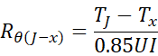
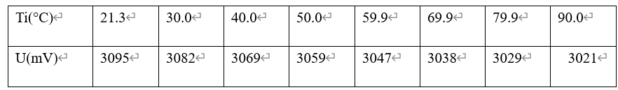
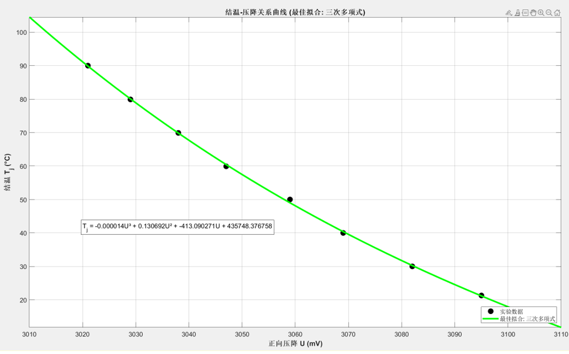
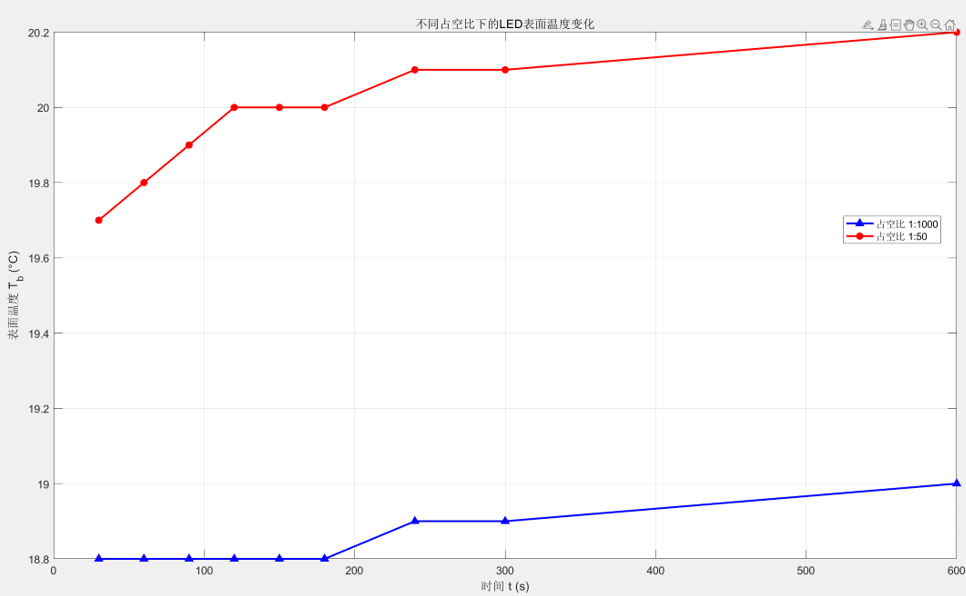
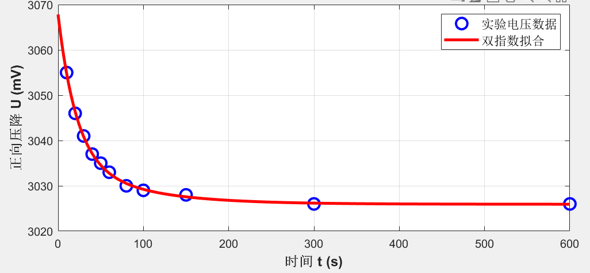
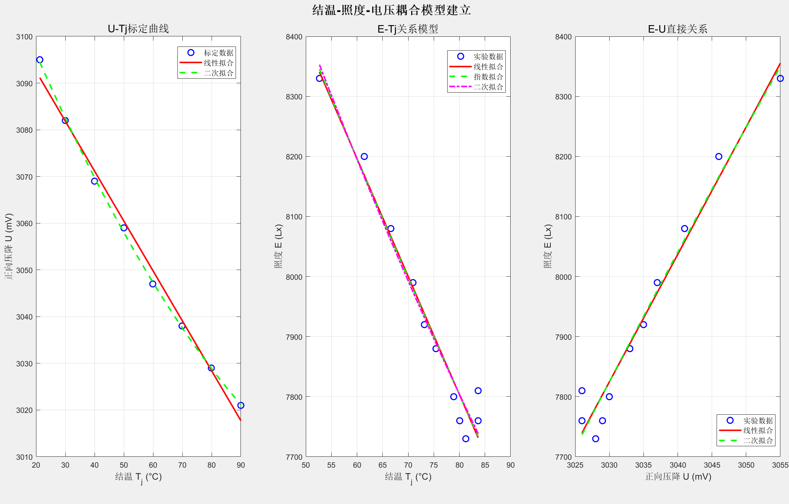

# 大功率LED结温测量方法的扩展

**zhz**

*（东南大学电子科学与工程学院，南京 210096）*

**摘要：**本文基于大学物理选修实验“大功率LED热学特性研究”，针对脉冲法测量结温中的参数优化、热阻模型构建以及实验数据处理流程进行了系统研究。针对实验相关内容进行课外研读，通过建立结温—照度—电压耦合模型，提出了一种更精确的LED的结温动态测量与热性能评估方法。本研究为LED热设计与寿命预测提供了实验支持，并在实验教学中提出了探索性环节。

**关键词：**大功率LED；结温测量；脉冲法优化；热阻分析

## The Extension of Junction Temperature Measurement Method for High-Power LEDs

**zhz**

*(School of Electronic Science and Engineering, Southeast University, Nanjing 210096)*

**Abstract:** This paper is based on the elective experiment of college physics, "Research on the Thermal Characteristics of High-Power LEDs", and conducts a systematic study on the optimization of key parameters in the pulse method for measuring junction temperature, the construction of thermal resistance models, and the data processing flow of experiments. By establishing a junction temperature-illuminance-voltage coupling model, a more accurate dynamic measurement method for junction temperature and thermal performance evaluation of LEDs is proposed. This research provides experimental support for the thermal design and life prediction of LEDs and proposes an exploratory link in experimental teaching.

**Key words:** High-power LED; Junction temperature measurement; Pulse method optimization; Thermal resistance analysis

大功率LED的发光效率、波长稳定性及使用寿命均严重依赖于其工作结温[1-2]。准确测量结温并评估散热性能，是LED器件设计与应用的核心环节。脉冲法虽能实现结温的间接测量，但在脉冲参数选择、动态热响应建模及多参数耦合分析方面仍有优化空间。并且现有实验流程中，数据记录、

*作者简介：zhz，东南大学电子科学与工程学院。*

处理与分析环节相对独立，不利于初学者系统理解LED的热学特性与光电特性之间的关联。

本文基于脉冲法原理，结合温控系统，系统研究了大功率LED在不同工作模式下的结温变化规律，并分析了结温对其光电性能的影响。

## 1 实验原理与现有方法分析

### 脉冲法测量结温的基本原理

脉冲法的核心思想是通过施加低占空比的脉冲电流，使LED在脉冲间歇期内充分冷却，从而使结温（Tj）与表面温度（Ts）趋于一致。在此基础上，通过温控系统改变表面温度，可标定出特定电流下正向压降（U）与结温（Tj）的关系曲线：

Tj=f(U)           （1）

测量LED的工作电压，并考虑实际能量转化，即可反推得到热阻的近似公式：

（2）

其中，U 和 I 分别为 LED 两端的电压与流过 LED 的正向电流。

### 实验数据分析

**表1** 不同结温下LED的正向压降

通过脉冲法结合温控系统，测量了在300 mA电流下，LED在不同结温下的正向压降，数据如表1所示。使用三次多项式进行拟合，得到U−Tj ​关系曲线（R2=0.9996），拟合方程为：

Tj=−0.000014U3+0.130692U2−413.090271U+435748

结果表明，LED正向压降随结温升高而下降，表现出明显的负温度系数特性。

*图1 结温-压降曲线*

### 现有实验方法的局限

脉冲参数少：实验仅使用1:50与1:1000两种占空比，未系统研究占空比、脉宽对测量稳定性的影响。

热阻模型单一：仅计算稳态热阻，未考虑瞬态热响应，无法反映器件内部热结构。

数据流程分散：数据记录、拟合、绘图与分析依赖人工操作与软件分析，效率低且易出错。

实验验证性强，探索性弱：学生按固定步骤操作，缺乏对“最佳测量条件”的探究环节。

## 2 实验方法改进与优化策略

### 脉冲参数的系统优化研究

提出“可变占空比脉冲”，在保持平均电流相同的条件下，改变占空比（如1:10、1:50、1:200、1:1000），研究：

不同占空比下 U−Ts曲线的稳定性；

脉冲间歇期结温与表面温度趋于一致的最小时间常数[3]。

将从实验室带出来的数据输入到MATLAB软件中得出占空比不同条件下U-Ts曲线：

*图2 不同占空比下LED表面温度变化*

可以看出，低占空比(1:1000)下温度基本不变，高占空比(1:50)下温度有小幅上升但变化很小。最小时间常数上，占空比(1:1000)的较小，温度较为稳定。但由于样本量少，且缺乏足够的数据支撑，实验结论不能得到足够的支撑。

### 将热阻模型从稳态扩展到瞬态

为深入揭示大功率LED的多层次热结构特性，本节在传统稳态热阻基础上，引入瞬态热阻分析。通过对LED开启后 Tj(t) 与 Ts(t)上升曲线进行双指数拟合：

T(t)=T0+A1(1−e−t/τ1)+A2(1−e−t/τ2)    （3）

其中 τ1、τ2可分别对应“结到壳”与“壳到环境”的热时间常数，这种模型将LED简化为一个两阶热网络，更细致地表征器件的热结构[3]。

时间常数特征遵循：τ1​ 小：说明芯片到基板散热路径良好；τ2 大：说明整体散热器热容较大或环境散热不良。

目标：将测量得到的稳态总热阻分解，揭示LED内部的热传递路径。

### 结温—照度—电压耦合模型的建立

基于实验数据，建立包含结温（Tj）、正向压降（U）与照度（E）的经验耦合模型：

E(Tj)=E0⋅e−k(Tj−T0)或E(U)=a⋅U2+b⋅U+c  （4）

该模型可用于预测LED在不同散热条件下的光输出衰减。[4]

### 两个模型的实验数据验证

#### 数据如何用于瞬态热阻分析

现有的数据构成了一个完美的阶跃响应实验：

**表2** 不同时间的结温（室温：18.8°C）

激励：在t=0时刻，对LED施加一个300mA的直流电流阶跃。

响应：记录下了结温 Tj(t)随时间 t 从初始值（室温附近）上升至稳态值（约83.66°C）的完整曲线Tj(t)。

采用双时间常数模型，将LED简化为一个两阶热网络，对应两个主要的热传递阶段：

芯片→基板（快速过程）：时间常数 τ1 ​，热阻 Rθ1​。

基板→环境（慢速过程）：时间常数 τ2 ​，热阻 Rθ2​。

由于电压和结温满足线性关系，分析对象电压(直接测量量)衰减曲线可以用双指数函数拟合：

U(t)=U0+ΔU1(1−e−t/τ1)+ΔU2(1−e−t/τ2)（4）

其中各段热阻：Rθi=ΔTi/Pd，Pd为热耗散功率（≈0.85UI）。

*图3 LED正向电压双指数拟合曲线*

双指数电压拟合模型：

U(t) = 3025.9 + 31.5·exp(-t/21.4) + 10.4·exp(-t/80.3) mV

电压和结温标定线性关系有dU/dTj=-1.4mV/°C

由此可得：快速过程：ΔT1 ≈ 22.5 °C, τ1 ≈ 21.4 s；慢速过程：ΔT2 ≈ 7.4 °C, τ2 ≈ 80.3 s。总等效温升ΔT ≈ 29.9 °C；热耗散功率 Pd = 0.85 × (3.026 V) × 0.3001 A = 0.7719 W；等效热阻估算：快速路径等效热阻 R1_eq ≈ 29.1 °C/W；慢速路径等效热阻 R2_eq ≈ 9.6 °C/W；总热阻为38.7°C/W；实验报告热阻（结到表面）R_θ_j-x = 23.534 °C/W。实验结果表明：芯片到基板的热响应时间约为21.4s, 基板到环境的热响应时间约为80.3s。与实验室推荐的稳态热阻分析相比，该实验理论结果没有实验推荐方法的结论可信。

据此，我的分析是：该双指数模型基于理想阶跃响应的理论拟合，而在实验室中人为上无法控制瞬间将电流加到300mA，只能够尽可能快得满足实验条件；在实验室中仅测量11个数据点，时间分布不均匀，也在一定程度上影响了模型参数精度。

尽管存在上述局限，本研究引入双指数模型的价值在于：传统的单指数模型将LED视为单一热容-热阻系统，这过于简化了实际的热传递过程。双指数模型对应二阶网络，能更真实地反映LED封装的多层结构，更有助于我们理解它的微观机理。基于双指数模型，可优化LED的工作策略进行寿命预测，进而更有利于实际生产中。

本工作在传统稳态热阻测量基础上，创新性地引入双指数模型分析LED的瞬态热响应。这不仅加深了我对LED热物理过程的理解，更将基础实验提升至研究性学习的高度，体现了“从实验中学习，在研究中创新”的格物致知理念。

### 结温—照度—电压耦合模型的实验验证

基于现有的实验数据设计一个基于该理论的实验验证方案：

**表3** 结温对照度的影响实验（直流工作状态）

室温：18.8°C  电流幅值：300.1mA

基于实验数据建立了结温(Tj)、照度(E)与正向压降(U)之间的定量关系模型，并进行系统的验证分析。

模型建立使用了两个关键数据集：1）表3的U-Tj标定数据；2）表2的直流工作瞬态数据。首先建立U-Tj转换关系，进而建立E-Tj关系，最终形成完整的U→Tj→E预测链。采用线性、指数和二次多项式等多种模型进行拟合。

*图4 结温—照度—电压耦合模型验证*

E-Tj线性模型：0.45%

E-Tj指数模型：0.46%

E-Tj二次模型：0.67%

E-U线性模型：0.48%

E-U二次模型：0.69%

结果表明，线性和指数模型在E-Tj关系中表现最优，平均预测误差为0.45%左右。此外，计算得到LED温度每升高10°C，照度下降约6.2%。

本节基于实验数据建立了大功率LED的结温-照度-电压耦合模型，并通过交叉验证证明了模型的有效性。模型揭示了LED热-电-光性能之间的内在联系，为通过电学测量间接监测光学性能提供了可行方案。

本实验基于部分数据和恒定电流条件的建立，且未考虑LED老化、波长漂移等因素[3-4],因而存在一定的局限性。

## 3 总结与归纳

LED不仅是一项基础的光电子技术，更是推动现代照明、通信以及能源变革的核心动力。它虽已无处不在，但其潜力远不如此。提升寿命、解决散热问题也尤为重要。

在本学期的大学物理实验中，我因为对LED的好奇选择了该实验并学习了LED热学特性的相关知识，基于该实验，我对脉冲法测量结温的关键环节进行了系统性的优化与拓展研究。主要工作与创新点如下：

1. 提出了脉冲参数的优化思路：通过提出可变占空比脉冲实验的设计方案，初步探讨了占空比对测量稳定性的影响。

2. 引入了瞬态热阻分析模型：在传统稳态热阻基础上，创新性地采用双指数函数拟合LED的开启热响应过程，尽管该实验设计存在一定的局限性，但这种方式更精细地表征了LED内部的多层热结构及其动态传热特性。

3. 建立了结温—照度—电压耦合模型：基于实验数据，构建并验证了LED关联电学参数的经验模型，得出多模型拟合的可行性。

4. 本研究完成了对现有实验方法的验证，更通过模型构建与数据分析，将实验内容从操作模仿提升至原理探究层面，体现了“在实验中研究，在研究中学习”的格物致知理念。

通过本次研究，不仅深化了我对大功率LED热学特性的理解，更锻炼了综合运用物理原理、数学建模与数据处理解决实际工程问题的能力，为后续的专业学习与相关研究奠定了基础。

## 参考文献

[1] 陈乾, 戴玉蓉, 孙贵宁, 等. LED热学特性研究及应用实

验仪[J]. 物理实验, 2017, 37(7): 39-42.
[2] 余彬海, 王浩. 结温与热阻制约大功率LED发展[J]. 发

光学报, 2005, 26(6): 761-766.

[3] 董涛, 李毅, 陈明祥等.“大功率LED封装的瞬态热测

试与结构函数分析.” 发光学报, 2014, 35(11): 1389-1395.

[4] 王宏兴, 王小华, 荣命哲等. “基于结构函数的大功率

LED热阻测试与分析.” 光电子·激光,  2012, 23(6):

1054-1059.

| 时间 t(s) | 结温 Ti(°C) | 电压 U(mV) |
|---|---|---|
| 10 | 52.67 | 3055 |
| 20 | 61.43 | 3046 |
| 30 | 66.62 | 3041 |
| 40 | 70.94 | 3037 |
| 50 | 73.16 | 3035 |
| 60 | 75.42 | 3033 |
| 80 | 78.89 | 3030 |
| 100 | 80.06 | 3029 |
| 150 | 81.25 | 3028 |
| 300 | 83.66 | 3026 |
| 600 | 83.66 | 3026 |

| 时间  t(s) | 表面温度 Ts(°C) | 电压 U (mV) | 结温 Ti (°C) | 照度E(104Lx) |
|---|---|---|---|---|
| 10 | 33.4 | 3055 | 52.67 | 0.833 |
| 20 | 42.3 | 3046 | 61.43 | 0.820 |
| 30 | 48.9 | 3041 | 66.62 | 0.808 |
| 40 | 52.9 | 3037 | 70.94 | 0.799 |
| 50 | 55.9 | 3035 | 73.16 | 0.792 |
| 60 | 57.9 | 3033 | 75.42 | 0.788 |
| 80 | 60.7 | 3030 | 78.89 | 0.780 |
| 100 | 62.3 | 3029 | 80.06 | 0.776 |
| 150 | 64.1 | 3028 | 81.25 | 0.773 |
| 300 | 65.5 | 3026 | 83.66 | 0.776 |
| 600 | 66.6 | 3026 | 83.66 | 0.781 |
