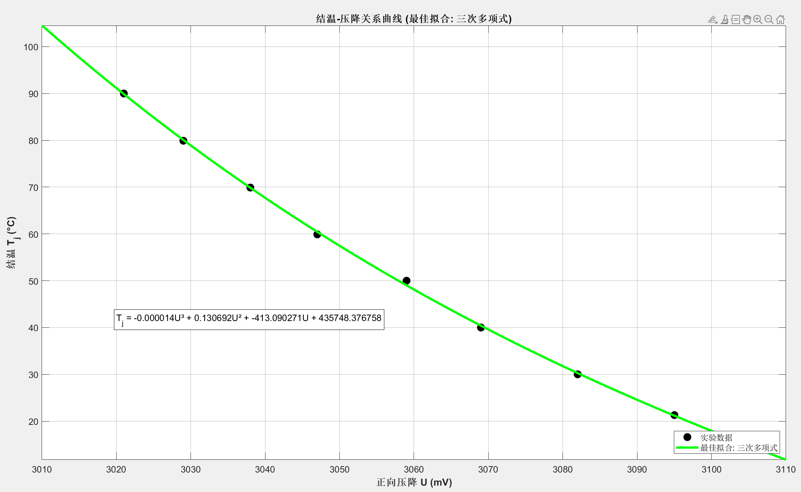
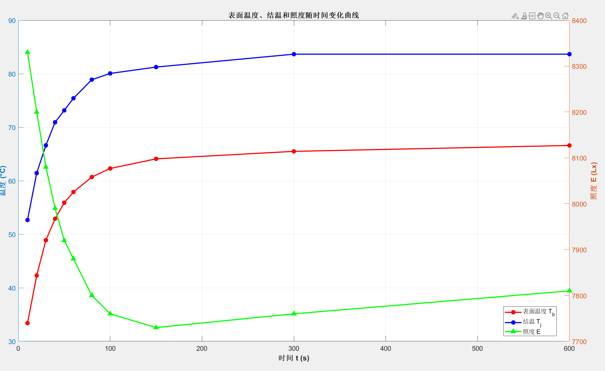
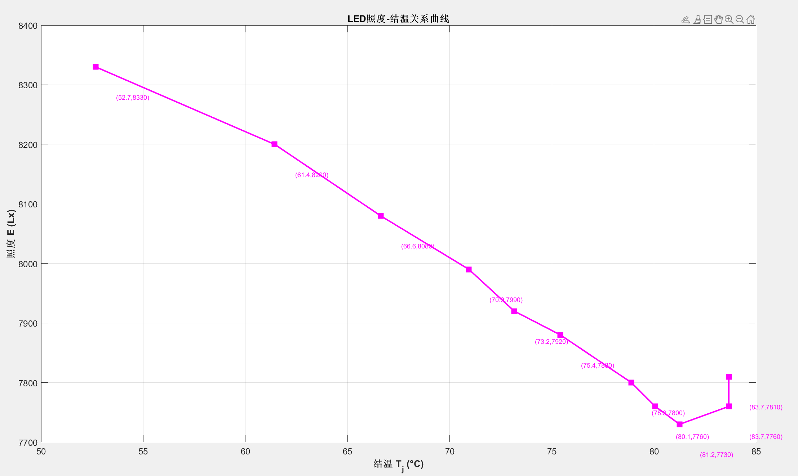
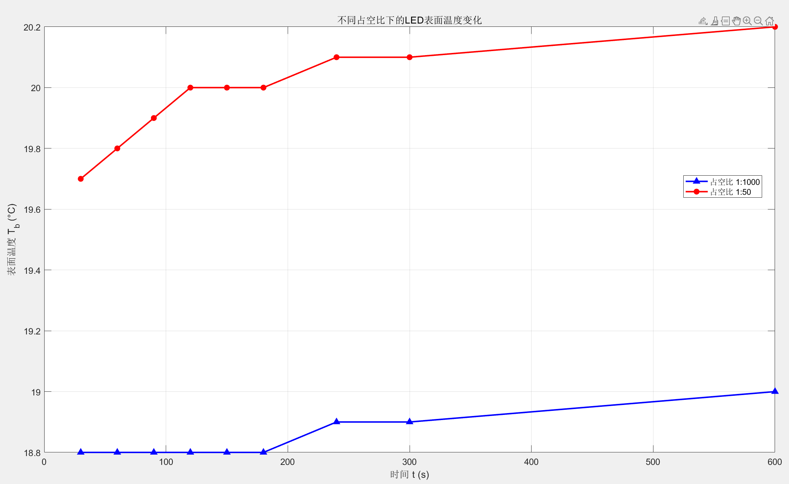
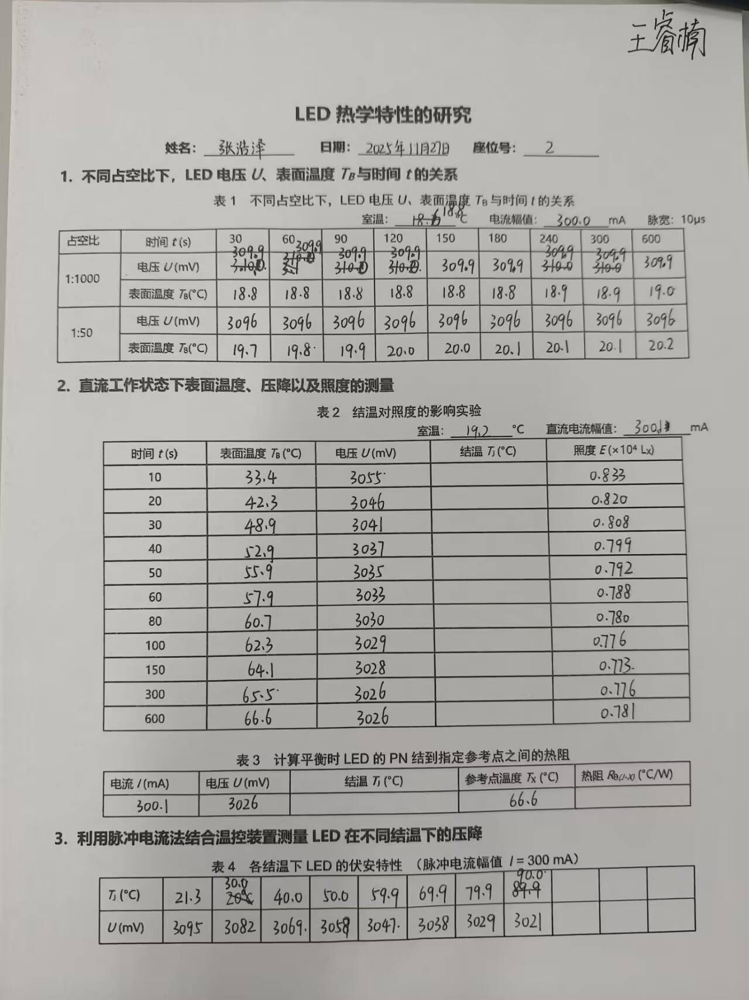

# 大功率LED热学特性研究

指导教师：xxx

姓名：zhz　　学号：（已隐去）　　桌号：2　　日期：2025年11月27日

---

实验名称：大功率LED热学特性研究  指导教师：xxx

姓名：zhz  学号：（已隐去）  桌号：2  日期：2025年11月27日

实验报告格式要求：中文字体宋体、英文字体Times New Roman、字号小四、行间距1.5倍；图表应有题注及编号。

实验报告内容包括：

实验简介（实验背景、原理、实验方法等）

实验仪器

数据与分析（数据表格、数据作图、必要的数据处理过程、结果分析）

实验小结

附录（将课堂上的原始数据拍照附于此处，原始数据上需有教师签字）

(-----------------------------------以下为正文-----------------------------------)

一、实验简介

1、实验背景

发光二极管（LED）已从低功率指示灯光源，迅速发展并被广泛应用于日常照明和显示领域。对于大功率照明用LED，其工作时产生的热量会大幅提高，这将直接导致LED发光效率下降、器件使用寿命缩短、发光波长漂移等一系列问题。因此，研究功率型LED的热学特性至关重要。

2、实验原理

本实验的核心原理包括脉冲法测量结温和LED热阻的概念。

脉冲法测量结温

目的：LED的结温（PN结温度）无法直接测量，需要采用间接方法。

方法：给LED施加一个幅值为额定值但占空比极低（如1:1000）的脉冲电流。在脉冲间歇期，芯片有足够时间冷却，使其结温（TJ）与器件表面可测温度（TB）趋于一致。

标定与应用：在此状态下，通过温控仪改变表面温度，即可标定出特定电流下芯片两端电压与结温（U-TJ）的关系曲线。由于在恒定电流下，PN结压降仅与结温有关，因此在后续正常工作时，通过测量LED的工作电压，即可利用此曲线反推出其实际结温。

LED热阻

定义：热阻是导热介质两端的温度差与通过热流功率的比值，反映了散热能力的强弱。LED的热阻定义为：

其中，TJ为结温，TX为指定参考点温度，PH为热耗散功率。

近似计算：通常认为约85%的输入电功率转化为热量，因此热阻可近似为：

其中，U和I分别为LED两端电压与正向电流。

意义：热阻越小，散热能力越强，在相同功率下结温越低，从而有助于提升LED的寿命和发光效率。

3、实验方法

本实验主要通过以下方法进行研究：
（1）使用不同占空比的脉冲电流驱动LED，记录电压和表面温度随时间的变化，分析占空比对结温的影响。

（2）在直流工作状态下，测量LED表面温度、电压和照度随时间的变化，并计算稳态热阻。

（3）利用脉冲电流法结合温控装置，测量LED在不同可控结温下的正向压降，建立电压-温度特性曲线。

二、实验仪器

本实验所使用的仪器为“LED热学特性研究及应用实验仪”，主要包括以下四个部分：

激励电源

提供驱动LED的电流。具有0~40 mA和0~350 mA两档恒流输出，具备“输出调节”旋钮和过载保护功能。

LED特性测试仪

是核心控制与测量单元。具备“直流/脉冲”模式切换功能；脉冲模式下可选三种占空比：1:50、1:100、1:1000；集成电压表（范围：-9.99~9.999 V）和电流表（范围：0~999.9 mA）；集成照度表（范围：0~19999 Lx，分辨率1 Lx）；配有“测试”、“复位”等功能按钮。

温控仪与测试台

用于控制LED基板温度。控温范围：室温 ~ 120.0 °C；最多可进行11档控温，每档间隔10 °C；控温精度优于0.5 °C；测试台：承载LED灯珠；采用贴片式PT1000作为温度传感器，用于精确测量芯片陶瓷基板的温度（作为参考点温度 T_X ）。

照度传感器

用于测量LED的光输出。其光谱响应接近人眼视觉，峰值灵敏度波长为560 nm。

三、实验数据与分析

1、实验数据记录

不同占空比下，LED电压 U、表面温度 TB与时间 t的关系

表1：不同占空比下，LED电压 U、表面温度 TB与时间 t的关系

室温：18.8°C  电流幅值：300.0mA

直流工作状态下表面温度、压降以及照度的测量

表2：结温对照度的影响实验（直流工作状态）

室温：18.8°C  电流幅值：300.1mA

表3：计算平衡时 LED 的 PN 结到指定参考点之间的热阻

利用脉冲电流法结合温控装置测量LED在不同结温下的压降

表4：各结温下LED的伏安特性（脉冲电流幅值I=300 mA）

2、实验数据的分析：

结温-压降特性分析（表4）

使用matlab软件对实验数据进行三次函数拟合，得到相关系数R² = 0.999623，拟合方程Tj = -0.000014·U³ + 0.130692·U² + -413.090271·U + 435748.376758（四舍五入简化显示，计算时使用的是精度更高的函数表达式）

从结温-压降曲线可以看出，LED的正向压降与结温呈现良好的单调递减关系。随着结温从21.3°C升高到90.0°C，正向压降从3095mV下降到3021mV，表现出明显的负温度系数特性。这种关系验证了半导体PN结的温度特性，为间接测量LED结温提供了理论基础。通过测量工作电压即可准确推算实际结温。

时间特性分析（表2）

图表显示：表面温度和结温在初始阶段快速上升，约300秒后趋于稳定；结温始终显著高于表面温度，平均温差约17°C；照度随温度升高而下降，从8330Lx降至7730Lx。根据数据推理可知LED需要有效的散热设计来控制结温，以维持稳定的光输出性能。

照度-结温关系分析（表2）

照度与结温呈负相关关系，结温从52.7°C升高到83.7°C时，照度从8330Lx下降到7730Lx，降幅约7.2%。

占空比影响分析（表1）

低占空比(1:1000)下温度基本不变，高占空比(1:50)下温度有小幅上升但变化很小。所以在实验时间范围内，两种占空比下的温升都很小，说明脉冲工作模式能有效控制平均结温。

3、问题思考与回答

实验过程中不同步骤先后顺序的确定原则是什么？是否可以调整？调整后的优缺点是什么呢？

确定原则：遵循"从标定到测量、从简单到复杂"的逻辑顺序。先进行脉冲法标定建立电压-温度基准关系，再进行直流工作状态的实际测量。我认为不可以调整，如果调整顺序，将无法准确标定电压-温度关系，导致后续结温测量存在系统误差。正确的顺序确保了测量结果的准确性和可靠性。

实验中可能存在的误差影响因素有哪些？如何去除或减弱影响？

主要误差源：温度、电压测量产生的偶然误差；手动记录的时间点偏差，人体反应时间影响数据准确性；环境温度波动会影响表面温度测量；电流的不稳定性会影响电压读数。消除方法：使用录像采集系统减少人为误差；尽可能控制实验开始温度一定；提高实验仪器稳定度。

结晶-压降曲线拟合过程中函数应该如何选择？

选择依据：首先考虑曲线拟合，一次函数拟合属于线性关系，而实际中它不是严格线性关系，因为参数刚好使得线性关系较好，所以选择高次函数拟合。其次考虑拟合优度：通过R²值等指标评估拟合质量。最终选择三次函数拟合。

四、实验小结

本实验系统研究了大功率LED的热学特性，主要成果如下：

建立了结温测量方法：通过脉冲法标定了电压-温度关系曲线，实现了LED结温的间接测量。

揭示了热效应对LED性能的影响：随着结温升高，LED正向压降下降，光输出衰减。

计算出了热阻参数：计算得到热阻为22.097°C/W，说明其散热性能好。

工作模式的影响：脉冲工作可有效控制温升。

实验数据较为准确可靠，成功验证了LED的热学特性理论，为LED的热设计和使用提供了重要的实验依据。

五、附录

| 占空比 | 时间 t(s)t(s) | 30 | 60 | 90 | 120 | 150 | 180 | 240 | 300 | 600 |
| 1:1000 | 电压 U(mV) | 3099 | 3099 | 3099 | 3099 | 3099 | 3099 | 3099 | 3099 | 3099 |
|  | 表面温度 TB(°C) | 18.8 | 18.8 | 18.8 | 18.8 | 18.8 | 18.8 | 18.9 | 18.9 | 19.0 |
| 1:50 | 电压 U(mV) | 3096 | 3096 | 3096 | 3096 | 3096 | 3096 | 3096 | 3096 | 3096 |
|  | 表面温度 TB(°C) | 19.7 | 19.8 | 19.9 | 20.0 | 20.0 | 20.0 | 20.1 | 20.1 | 20.2 |

| 时间 t(s)t(s) | 表面温度 TB(°C) | 电压 U(mV) | 结温 Ti(°C) | 照度E(104Lx) |
| 10 | 33.4 | 3055 | 52.67 | 0.833 |
| 20 | 42.3 | 3046 | 61.43 | 0.820 |
| 30 | 48.9 | 3041 | 66.62 | 0.808 |
| 40 | 52.9 | 3037 | 70.94 | 0.799 |
| 50 | 55.9 | 3035 | 73.16 | 0.792 |
| 60 | 57.9 | 3033 | 75.42 | 0.788 |
| 80 | 60.7 | 3030 | 78.89 | 0.780 |
| 100 | 62.3 | 3029 | 80.06 | 0.776 |
| 150 | 64.1 | 3028 | 81.25 | 0.773 |
| 300 | 65.5 | 3026 | 83.66 | 0.776 |
| 600 | 66.6 | 3026 | 83.66 | 0.781 |

| 电流 I(mA) | 电压 U(mV) | 结温 Ti(°C) | 参考点温度 Tx(°C) | 热阻 (°C/W) |
| 300.1 | 3026 | 83.66 | 66.6 | 22.097 |

| Ti(°C) | 21.3 | 30.0 | 40.0 | 50.0 | 59.9 | 69.9 | 79.9 | 90.0 |
| U(mV) | 3095 | 3082 | 3069 | 3059 | 3047 | 3038 | 3029 | 3021 |
