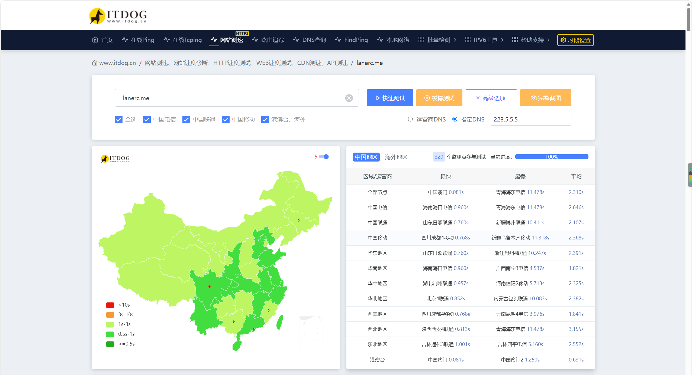
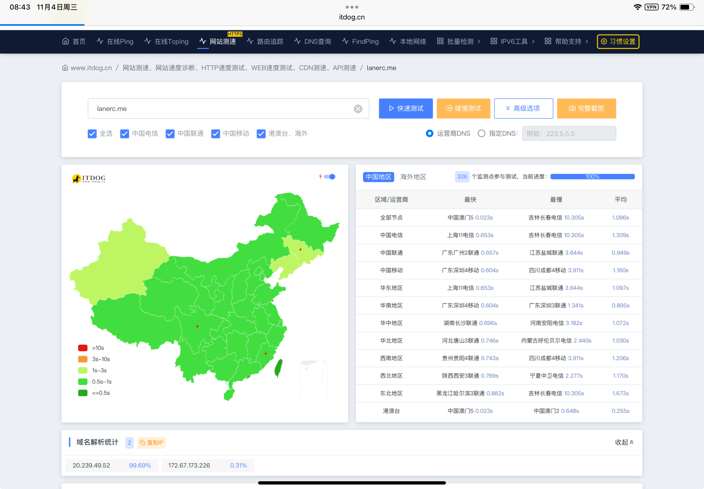
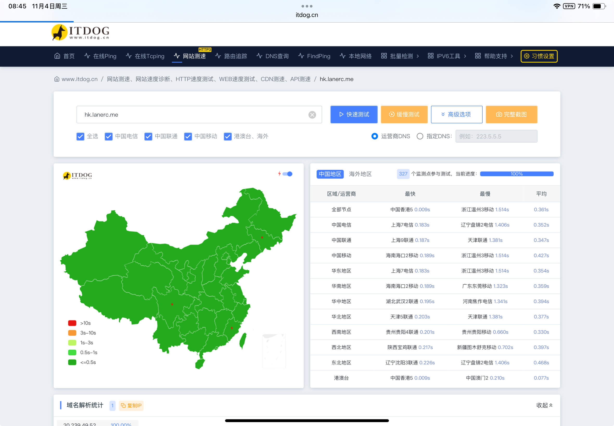
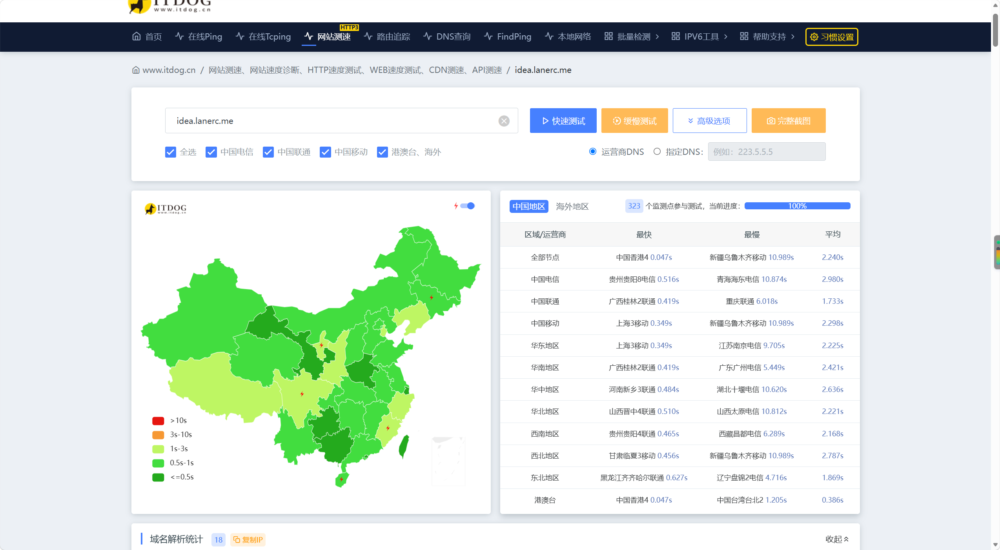

---

title: 给站点添了些功能，顺便加了个对照组
published: 2026-11-07
description: 灵感屋上线后又添了两样：能走自建解析的播放器、跟主站共用一份数据的日历页。顺便把它跟主站明信摆一起对照了一下——同一套逻辑，一边是我下命令让 AI 写的，一边是主站的源码实现。
image: ./cover.webp
tags:

- 博客
- 折腾
- 播放器
- 日历
category: 博客
series: 博客搭建
seriesOrder: 7
draft: false

---

## 一、为什么会有个对照组

灵感屋（[idea.lanerc.me](https://idea.lanerc.me)）11 月 5 号才上线，这两天又给它添了两样东西：一个能走自建解析的播放器，一个跟主站共用一份数据的日历页。添着添着想起来，主站的第七个形态明信，底子跟它本来就是同一套——一边是整站，一边是形态，正好摆一起当个对照组。这篇就记一下添加的功能，顺便把当初为什么建这个站交代在前面。

一是想试试 Vercel 建站，观察到vercel上面的项目明显延迟低。主站跑在 Cloudflare 上，国内访问是靠香港前置才顺起来的，总觉得这条路有点绕。这次换个场子，整站扔 Vercel，再配个优选 IP，看看什么水平。印象里 Vercel 这么玩不违规；CF 那边我是不敢再打擦边球了。

二是替朋友踩坑。最近有朋友想建站，问我怎么弄，我说你等我先拿 AI 全自动走一遍，坑踩完了写成教程你照着抄。刚发在灵感屋的那篇[保姆级教程](https://idea.lanerc.me/posts/ai-hosted-blog-guide/)就是这么来的。顺带说一句，这个站不打算大改，底目前够用，小地方修修就行。

三是跟主站对照着找灵感。最近给主站做优化，老盯着同一套代码看，脑子容易僵。换个底子、换个平台做同样的事，播放器做一遍、日历页做一遍，两边一比，经常能发现主站那边没想到的做法。

四是给学习笔记找个地方放。主站友链博主越来越多，首页刷出来全是同行，这种时候往主站塞专业课笔记，我自己都觉得不好意思——人家是来看博客折腾的，又不是来看我课程表的。笔记先扔旧站和灵感屋存着，有空再慢慢往主站搬。

灵感屋的地址是 idea.lanerc.me。底子是 MmzMing 的 [my-blog](https://github.com/MmzMing/my-blog)，fork 下来独立成站。

## 二、同一个底子，两个实现：明信和灵感屋

主站第七个叫明信，布局、播放器、标签页那张知识图谱，都是照 mmz 这套 my-blog 搬进主站的。它就是个形态，穿在主站身上，文章、评论、统计全用主站自己的，访客在调色板里点一下就换上，后端什么都不用动。

灵感屋是反着来的。整仓 fork，独立成站。自己的文章、自己的评论后端、自己的部署，日历数据是拉取的主站的，其他没有主站的内核。

所以同一套设计，一边是个主题，一边是个站。下面讲播放器正好横跨两边：灵感屋那边是我拿命令堆出来的，主站明信这边是正经写死的实现，一起讲，正好记录一下。

## 三、播放器：灵感屋靠命令，主站靠实现

播放器是这个站最费劲的一块。原装的走公开 Meting 实例，和我的需求不搭：QQ 歌单能拉到歌名、歌手、封面，一点播放，404；网易云的受限曲只给 30 秒试听。这样不行，一定要都能拉取到音乐源。

### 灵感屋这边：直接给 AI 下命令

这边的播放器我没写一行代码，全是嘴上指挥。关键的就几句。

先把歌单改成可切换的列表配置，每张单子留一个「走谁」的开关：

```
请把播放器歌单改造成列表配置：每张歌单包含名称、平台、歌单 ID 和 api 字段，api 为 self 时请求自建的歌单/解析接口，为公共源地址时走 Meting。切歌单时不要打断正在播放的歌曲，点了新歌单里的歌才切换队列。
```

再让它照主站的逻辑写自建解析：

```
请为播放器实现自建解析：歌单接口按 trackIds 每批 100 首并发补详情并保持原顺序；解析接口按多源回退找可播地址，每个候选先实际请求验活再返回，验不过换下一个，结果缓存 6 小时。
```

以上两条命令都是多轮迭代总结出来的，修了大概两三轮。

最后是提速。冷加载十几秒，我把现象甩给它，让它自己查自己改，改完交对照数据。它给的结论是三样叠一块了：节点跨国、补详情串行、缓存太短。三批改动它自己分开提交，我只负责真机点一遍听听响。

配置上：**加歌单只许加一行，不许动代码。**现在一行长这样：

```ts
{ label: "我喜欢的音乐", server: "netease", id: "2804070207", api: "self" }
```

`api: "self"` 就是这张单子不走公开实例、走我自己解析的意思。现在挂了六张：网易云一张、QQ 四张，这五张全是 self，再加一张本地歌单垫底。

### 主站明信这边：同一套逻辑，平台不同略有差异

主站这边没命令，全是写死的代码。明信播放器自己不带引擎，走的就是本站浮动播放器这条链：配置、歌单接口、解析接口，挨个贴。

配置在 `src/config/musicConfig.ts` 的 `floatingPlayer` 一节，歌单一行一条：

```ts
floatingPlayer: {
    enabled: true,
    quality: "320k",
    playlists: [
        { platform: "wy", id: "2804070207", label: "我喜欢的音乐" },
    ],
},
```

配置过程就这些：加歌单往 `playlists` 里加一条 `{ platform, id, label }`，platform 是 wy（网易）/ tx（QQ）/ kg（酷狗）；接口不用单独部署，两个文件放在 `functions/api/music/` 底下，是 Cloudflare Pages Functions，跟着站点推送一起上线；还有一处别漏——两个接口开头都有一份来源白名单（给我整怕了），只放行自家域名，新域名不先写进 `ALLOWED_HOSTS`，调用直接 403。

歌单接口 `functions/api/music/playlist.js` 负责拉全单。网易云的坑代码注释里写着：详情接口只给前几首，321 首的单子实测只回 6 首，全量 ID 在 `trackIds` 里，缺的按每批 100 首补齐再按原序拼：

```js
const byId = new Map();
for (const t of pl.tracks || []) byId.set(String(t.id), t);
const ids = (pl.trackIds || [])
    .map((x) => String(x?.id ?? x))
    .filter((x) => x && x !== "undefined");
const orderedIds = ids.length ? ids : [...byId.keys()];
const missing = orderedIds.filter((x) => !byId.has(x));
for (let i = 0; i < missing.length; i += 100) {
    const batch = missing.slice(i, i + 100);
    const c = encodeURIComponent(
        JSON.stringify(batch.map((x) => ({ id: Number(x) || x }))),
    );
    const t2 = await fetchText(
        `https://music.163.com/api/v3/song/detail?c=${c}`,
        { Referer: "https://music.163.com/" },
    );
    const d2 = JSON.parse(t2);
    for (const song of d2?.songs || []) byId.set(String(song.id), song);
}
const tracks = orderedIds.map((x) => byId.get(x)).filter(Boolean);
```

主站这边是串行补的，够用；灵感屋那边改成了并发，本机对照 788ms 降到 379ms，跨国节点上差得更多。

解析接口 `functions/api/music/resolve.js` 负责给直链，核心是这条回退链：星海、溯音、长青、念心挨个试，每家拿到候选先过 `probeUrl` 验活，验过才返回：

```js
const chain = buildSourceChain(platform);
const errors = [];
for (const handler of chain) {
    try {
        const result = await handler.fn(platform, songId, selectedQuality, songInfo);
        const candidate = validateUrl(result, handler.name);
        return await probeUrl(candidate);
    } catch (e) {
        errors.push(handler.name + ": " + (e?.message || e));
    }
}
throw new Error("所有源均失败: " + errors.join("; "));
```

验活是只摸第一个字节，4.5 秒超时，状态码、类型不对就直接跳过：

```js
async function probeUrl(url) {
    const res = await fetch(url, {
        method: "GET",
        headers: { Range: "bytes=0-0", "User-Agent": "Mozilla/5.0" },
        signal: AbortSignal.timeout(4500),
    });
    const finalUrl = res.url || url;
    if (res.status !== 200 && res.status !== 206) {
        throw new Error("验活失败 HTTP " + res.status);
    }
    const ct = (res.headers.get("content-type") || "").toLowerCase();
    const okType =
        ct.startsWith("audio/") ||
        ct.includes("octet-stream") ||
        /\.(mp3|flac|m4a|aac|ogg)(\?|$)/i.test(finalUrl);
    if (!okType) throw new Error("验活失败 类型 " + (ct || "未知"));
    // ……
    return finalUrl;
}
```

为什么非验不可：长青、念心这类模板源是同步拼地址、原样返回必「成功」，我线上实测长青给的网易云地址已经 404 了，还被抢先递给了播放器，从那以后所有候选**一律先验活再返回**。整条链都失败还有后手：拿歌名加歌手去别的平台找同一首歌，找到照样验活。缓存两层：解析结果进程内留 6 小时，接口响应再走边缘缓存 20 分钟——直链本身有有效期，不敢久存。

灵感屋的自建解析就是照这套复刻的，运行时换成 Vercel 的 Edge 函数。原版在这儿摆着，AI 那版跟它对得上对不上，看代码就行。

## 四、日历页：补一个坑

[日历页](https://lanerc.me/calendar/)主站先有，2026-10-27 上线的。想法：节假日、学校校历、自己的生日啥的，再加上文章和动态的发布日，全攒一页看。数据就三份，放主站仓库的 `calendar-data/` 底下：国家法定节假日、校历、个人记录。长这样，一条就是一天：

```json
{ "date": "2026-01-01", "name": "元旦", "type": "holiday" },
{ "date": "2026-01-04", "name": "元旦", "type": "workday" },
{ "start": "2026-08-29", "end": "2026-08-29", "title": "本科新生报到", "kind": "event" }
```

主站自己用起来没悬念，`src/utils/calendar-data.ts` 构建时直接 import 进去：

```ts
import holidays2026 from "../../calendar-data/holidays-2026.json";
import personalRecordsSeed from "../../calendar-data/personal-records.json";
import seuCalendar from "../../calendar-data/seu-calendar.json";

export function getBundledCalendarLayers() {
    return {
        holidays: { "2026": holidays2026 as HolidayDay[] },
        seu: seuCalendar as SeuItem[],
        records: personalRecordsSeed as PersonalRecord[],
    };
}
```

看见了吧，年份在主站这边是写死的 2026。主站自己维护，倒也不急；坑是留给来年和灵感屋的。

灵感屋的页面照主站做，数据不存第二份，存两份迟早对不上。它在构建期开了一个静态端点 `src/pages/api/holidays.json.ts`，专门去主站仓库拉这三份。**年份不写死**，先列目录、正则筛文件：

```ts
return entries
    .map((entry) =>
        entry && typeof entry === "object" && "name" in entry
            ? String((entry as { name: unknown }).name)
            : "",
    )
    .filter((name) => /^holidays-\d{4}\.json$/.test(name))
    .sort();
```

明年主站那边加个 `holidays-2027.json`，这边构建自己能发现。拉取带 8 秒超时和自定义 UA，拉下来还要过一层转换（`src/utils/calendar-data.ts`）：节假日按同名连续段算出每段总天数，校历只展开 event 条目按天铺开，个人记录直接转。有两点是写死在端点 GET 里的：

```ts
try {
    layers = await fetchLayers();
} catch (error) {
    // 构建期拉不到真源：用仓库内快照兜底，绝不让构建失败
    console.warn("[api/holidays.json] 拉取主站真源失败，改用仓库快照：", /* …… */);
    layers = fallbackLayers as CalendarLayers;
    fromFallback = true;
}
// ……
"Cache-Control": fromFallback
    ? "public, max-age=600"
    : "public, max-age=3600, stale-while-revalidate=86400",
```

博客构建挂掉，只因为拉不到一个 JSON，蠢不蠢——所以拉不到就用仓里的快照（`src/data/calendar-fallback.json`）顶上，只在控制台警告一句；用了快照就把缓存压到 600 秒，下次构建尽快跟上真源。还没完：页面在浏览器端打开后，会再直接拉一次主站 raw 覆盖一遍，静态数据先立住、真源随后跟上，拉失败就保留静态那份。浏览器端推年份还有个小抠法，只认节假日和调休两类往前推，不遍历全部事件，省掉瞎猜年份的请求，顺带消了两个 404。

主站这个日历页，当初就是参考 muyudada 的这篇教程做的：[muyudada 的 Firefly 日历页教程](https://muyudada.dpdns.org/posts/firefly-calendar-page/)

## 五、一个看不见但很烦的事

分享卡片。文章页分享出去是正常的 1200×630 卡片，首页、归档页分享出去却是被拉扁的方图。原因不复杂：非文章页的默认分享图用的是那张 256×256 的方形头像，微信不管你这个，方图照样铺满整张卡。最后不是补个标签了事，是补了张图：把文章卡片的渲染逻辑抽成共用的 src/utils/og-card.ts，加了个 /og/site.png 给站点页用，原来在两个地方各长一份的端点代码从 356 行压到 42 行。

但是QQ里面依旧不显示哈哈哈哈哈。

## 六、顺带：主站的前置和选线

要说主站最近拿得出手的，其实是香港前置。本体在 Cloudflare Pages 上，国内访问绕，解法是在 Azure 香港机前面加一层：DNS 灰云 A 记录直指过去，nginx 按 SNI 分流，HTML 缓存 200 秒（后续会考虑时间加长一些）、静态文件 30 天，[hk.lanerc.me](https://hk.lanerc.me) 当国内线，[origin.lanerc.me](https://origin.lanerc.me) 直连当海外线。

效果看测速图最直观：亚太访客走香港线稳在两三百毫秒，海外线在亚太偶尔能飘到一秒开外。所以公告里的链接做了自动分流，亚太走香港、其他地区走海外；光按地区猜还不准，后来又加了一段：页面空闲时让访客浏览器对两条线各测三次，哪条快用哪条，但得快出大约三成、且至少快 50 毫秒才许推翻地区名单，已经在最优线上的就不跳了，只弹个提示。



这是 11 月 2 号晚主站还直连时的图，全国平均 2.310 秒，也是上前置的直接原因。



前置的真实效果看主站自己这张：11 月 4 号早上修完回源卡顿之后复测，326 个节点平均 1.096 秒，99.69% 的节点解析到的已经是香港前置。这才是加上前置之后主站的速度。



最后这张 hk 的全图深绿、平均 0.361 秒，是张假图，放出来纯粹是提醒自己别再被深绿骗了：后来查清，itdog 从 http 起测，hk 的 80 端口当时还留着上线夜的 staging 占位块，明细里响应头写着 Content-Length: 17、text/plain——测到的只是一段 17 字节的空壳文本，根本不是博客本体。

前置也不是没出过事：11 月 4 号 nginx 解析源站域名失败，断了半小时，后来加了失败自启和解析加固。顺手还治了个老毛病——前置缓存过控制台文件，改个版本得清缓存，现在 /admin 直接不走缓存了。

灵感屋走的是另一条路：整站放 Vercel，不用前置中转。它在国内不慢，靠的是 Anycast 就近接入——亚洲访客多半落到香港、日本、新加坡的节点，再配上优选 IP，把解析指到对国内友好的那几个地址上。个人感觉大约有备案 CDN 七成的速度，在没备案的站里算很能打了。刚拿 Globalping 的国内 8 个探针实测了一把：全部返回 200，首字节 54 到 263 毫秒，总耗时的大头反而在 DNS 解析上——优选 CNAME 绕的那一圈，解析一次就要几百毫秒。



灵感屋自己的 itdog 是另一副样子：晚上十点多、晚高峰测的，323 个节点平均 2.240 秒。地图主体大片是 0.5 到 1 秒的绿，平均数主要是被几个 10 秒级的长尾节点拉上去的——晚高峰国际出口堵，电信最吃亏（平均 2.980 秒）。跟上面 Globalping 的数字别直接比：那个是云上探针测首字节，这个是家庭节点测整页下载，不是一个口径。这也是这个对照组有意思的地方：同一个问题，两边两个解法。

## 七、顺带：主站的手机端

这阵子主站主要对手机端进行一些优化。起因是 [lanerc.me](https://lanerc.me) 在安卓自带浏览器上又卡又白屏（Chrome 和 Safari 没事），我那台 OPPO 的自带浏览器尤其重。其实**桌面端也有类似的情况，显得很重**，每次大修都需要七个形态挨个过。

下手最重的是毛玻璃模糊，手机 GPU 弱，大面积的 backdrop-filter 一糊就掉帧。第一批就翻了车——听信 AI 谗言图省事给一堆本来没模糊的元素强行加上了模糊，弱浏览器当场散架，整批回滚。之后只压原本就有的、按面积点名，改完拿真机滑动验——没有任何改善。

这一轮就算失败了：忙活了几天，该卡还卡，该白屏还白屏，大头压根没找对。先记在这儿，找到再续。灵感屋底子轻，反倒没这毛病——这也是摆个对照组的好处，哪边重哪边轻，一目了然。

顺便在这儿求个助：哪位要是也遇到过这类站在安卓自带浏览器上又卡又白屏，或者知道真正的大头藏在哪，评论区说一声，感激不尽。我这边只排除了一样：毛玻璃不是大头，至少不全是。

## 八、接下来：这个二站怎么维护

旧站 [www.lanerc.me](https://www.lanerc.me) 是我日常写文章的地方，Obsidian 里写完自动就发上去了，只是站点本身不怎么动。灵感屋正相反，它就是用来动的，所以维护的路子大致是这样——但话说回来，精力也不会往里砸太多，它毕竟是第二个主站。

主要方向：一，灵感先行：新想法、新机制先在这边改，跑稳了再上主站，这块地本来就是干这个的。二，跟主站互相喂：主站最近在做网页优化，两边重叠的功能不少，这边试出来的好做法往主站搬，主站的经验也反过来喂这边。三，笔记慢慢搬：专业课笔记先在这边和旧站存着，陆陆续续往主站传，一次几篇，不刷屏。

从 fork 到现在一天多，25 个提交，这个站从套壳变成了现在这样：播放器能切六张歌单、走自建解析，日历页自己拉数据，分享卡片正常了，评论是独立的一套。

或许哪天它被我折腾得面目全非，希望以后他能更不一样，能出现一套自己的风格。