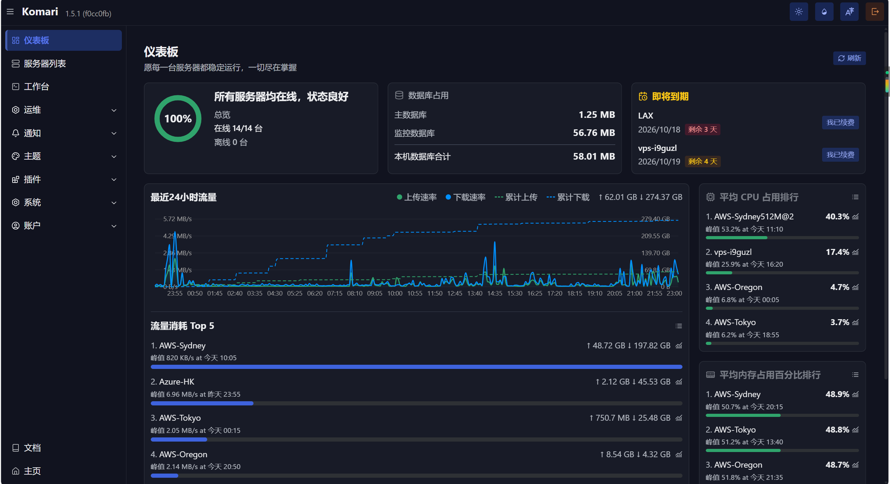
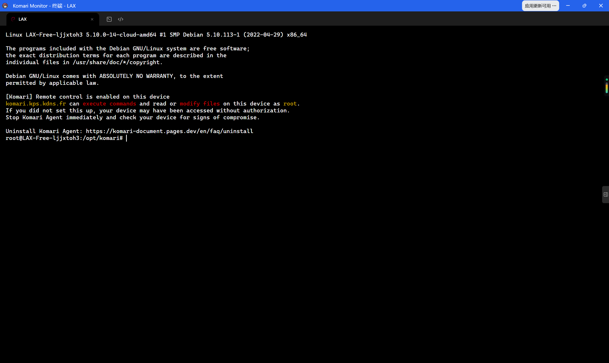
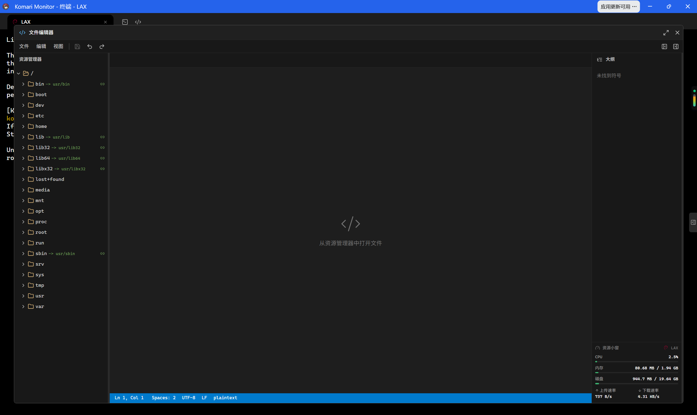

## Komari Monitor

基于 Komari 搭建的服务器监控面板，聚合展示多台 VPS 的运行状态、流量与到期提醒。

### 后台管理

管理后台的可视化做得非常好：服务器在线率、数据库占用、24 小时流量曲线、CPU/内存占用排行一目了然。

### WebSSH

新版的 WebSSH 非常好用——电脑没电的时候，直接用手机或平板打开网页端就能连上服务器继续操作，体验非常顺滑。终端、文件编辑器都在浏览器里开箱即用。

